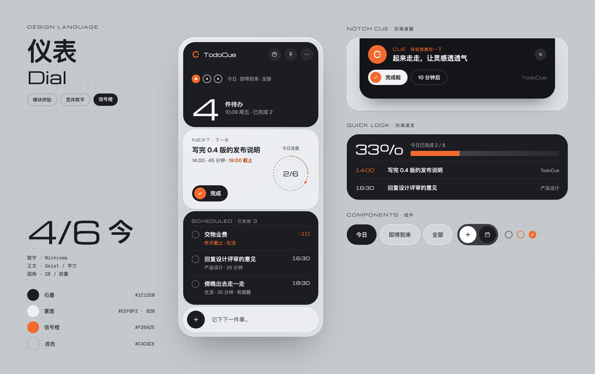

[English](README.md) · **简体中文**

> **v0.6.0 通用桌面正式发行：** Mac 与 Windows 改用共享 React/Tauri 客户端，安装包内置 Node、SQLite、后台通知和 Skill，无需另配运行时。[下载](https://github.com/NanmiCoder/TodoCue/releases/latest)提供 Mac Apple Silicon/Intel 与 Windows x64/ARM64。Mac 包签名并公证，Windows 包未签名。[升级、回退与边界](release-notes/v0.6.0.md)。硬件刘海适配仍由旧 v0.5.3 SwiftUI 客户端提供，通用版尚未接入；下文相关原生功能描述与截图保留为旧版参考。

<p align="center">
  
</p>

<p align="center">
  <strong>和 Agent 聊到的事，一句话变成待办。</strong><br>
  通过 Skills，让 Agent 用自然语言创建、管理任务与提醒。<br>
  TodoCue 把它们放在桌面手边，随时可见，到时提醒。
</p>

<p align="center">
  <a href="https://github.com/NanmiCoder/TodoCue/releases/latest"><strong>下载 Mac / Windows 版</strong></a> ·
  <a href="#安装-skills">安装 Skills</a> ·
  <a href="release-notes/">版本说明</a> ·
  <a href="LICENSE">MIT</a>
</p>

## 在对话里安排，在桌面上看见

和 Agent 写代码、讨论方案、推进不同项目时，总会聊到一些「待会儿做」「明天跟进」的事。直接让 Agent 记进 TodoCue，继续手头的对话。任务创建后，就能在原生 macOS 面板里看到；设置了提醒，到时间也会通知你。

**Agent 是 TodoCue 的主要交互入口。** 通过同一份 Skill，在 Claude Code、Codex、Cursor、WorkBuddy 等支持 Skills 且能执行本机命令的 Agent 中，用自然语言完成任务的创建、查询、修改与完成。不同项目、不同 Agent，管理的是这台电脑上同一份待办。

| 你可以这样说 | TodoCue 帮你记好 |
| --- | --- |
| 「用 TodoCue 明天上午九点提醒我检查这个项目的发布结果。」 | 创建任务，设置明确的提醒时间 |
| 「把刚才确定的三件事加入 TodoCue，归到网站改版项目。」 | 把对话中的行动项分别保存，按项目归类 |
| 「看看 TodoCue 今天还有什么没做。」 | 查询今天的待办和下一步建议 |
| 「把发布检查改到后天下午三点做，提醒也一起改过去。」 | 同时调整计划和提醒 |
| 「把 TodoCue 里的发布检查标记为完成。」 | 找到对应任务并更新状态 |

自然语言由你正在使用的 Agent 理解，任务和提醒由 TodoCue 保存与执行。也可以随时打开 App，手动填写表单或拖动任务调整顺序。

**开始使用：[下载并打开 App](#下载与安装) → [安装 Skills](#安装-skills) → 在 Agent 里说出要做的事。**

## 看清今天，只管下一步

Agent 创建的任务会同步出现在面板中。打开后，先看下一步建议，再看今天的其余安排。点开任务，备注、项目、预计耗时和截止时间都在同一处。

<p align="center">
  
</p>

**「仪表 Dial」是 TodoCue 的设计语言。** 一眼要看的放在石墨色块上，要动手处理的放在雾面块上；数字用宽体字，强调只用一种信号橙。各个块放在同一块托盘里（macOS 26 上是 Liquid Glass），换什么壁纸，面板看起来都是一个整体。完成任务时勾选标记会一笔画出，点阵表盘随之前进；提醒从刘海落下，并带一圈轻柔的波纹。窗口可在 300–600 点之间调整宽度并记住选择。 设置采用「通用、刘海、通知、数据」四个分区，统一开关、滑杆与选择器，支持深浅色和键盘操作；更改自动保存。

## 也可以打开面板，手动安排

不在 Agent 对话里时，在底部输入任务标题，回车就加入今天。需要更完整的安排时，点「添加详情」继续填写项目、优先级、时间、提醒或重复规则，已经输入的内容会保留。

面板可从顶部空白区域拖动，标题和备注里的鼠标拖拽用于选择文字。返回会保留草稿，新建草稿与各任务的编辑草稿分别保存；如果任务在别处发生修改，编辑器会保留当前输入，并提供重新载入最新任务的入口。

- **看得见做过什么。** 完成的事不会消失：从面板菜单或当天的已完成区打开「已完成」，按天回看，也能搜。点一下就能重新打开。
- **看得更远。** 从面板头部（⌘⇧K）打开日历，做过的、在做的和排到几个月后的任务在同一个平面上。可以在月视图和周视图之间切换，点某一天就展开这天的完整安排。改期直接把任务拖到另一天，时刻保留、截止与提醒不动；也可以直接往正在看的那天添加。超出 30 天预生成范围的重复任务会显示为「待生成」占位，而不是让远期月份看起来空空如也。
- **macOS：带到 iPhone 上。** 在设置 › 同步里打开「同步到日历」或「同步到提醒事项」，有日期的待办会出现在「TodoCue」日历或提醒事项列表里，经 iCloud 同步到 iPhone。双向同步：在那边改期、改标题或勾选完成，TodoCue 跟着变；删除即删除对应任务。推荐只开提醒事项：iOS 18 / macOS 15 起，带日期的提醒也会显示在日历里。仅在 App 运行时同步，不额外设闹钟。[详细说明](docs/apple-sync.md)
- **中英切换。** 在设置中选择简体中文或 English，立即生效并记住选择；首次启动跟随系统语言，任务内容保持原文。
- **待在手边。** 共享 React/Tauri 浮动面板与原生系统效果，支持浅色与深色外观。石墨色块始终保持深色；雾面块跟随系统外观，并模糊背后的桌面。
- **刘海就是入口。** 屏幕顶部的虚拟刘海显示今日剩余数；鼠标停上去就展开今日任务：下一步、逾期与已安排各项，可直接完成、稍后提醒、改期到明天，或回车添加新任务。点一下刘海可固定并直接输入，Esc 收起。设置 → 刘海可选择顶部、左侧或右侧停靠；顶部在带刘海的 Mac 上贴住屏幕顶边，中间按实际摄像头宽度留空，图标与任务数放在左右两侧；两侧各仅留 22 点，总宽不超过原默认 273 点，本机为 229 点；其他屏幕保持同样宽度并放进菜单栏：中间空着就居中，否则紧挨菜单栏图标、不盖住任何图标，放不下时才退到菜单栏下方。可跟随鼠标换屏，也可固定到检测到的某块显示器；断开时暂用主屏，重新连接后恢复。macOS 使用显示器 UUID 记住选择；不需要时可关闭。
- **顺序随手调。** 拖动任务时，上下条目平滑让位。「全部」可跨项目移动，「即将到来」可跨日期改期；「今日」在同组内调整顺序，支持撤销和恢复自动排序。
- **安排有后续。** 支持重复任务、提醒、稍后提醒，以及完成后的撤销。关闭面板后，后台服务继续负责提醒。
- **数据属于你。** 任务保存在 `~/.todocue/todocue.sqlite`。覆盖、删除或重新安装 App 后，这个目录仍然保留。

## 按你的节奏，提醒一点小事

告诉 Agent：「周一、三、六，九点到六点，每半小时提醒我起来活动。」Skill 一次调用就创建完整周期规则，返回实际配置和下一次提醒时间。直接用 App 时，在面板菜单选择**新建周期提醒**，选“活动 / 护眼 / 喝水 / 自定义”（每个模板都带着合适的间隔和计时方式），再点击间隔、星期和时段即可修改；时区默认收在“更多设置”里。

默认从你上次完成算起重新计时，不会在你刚站起来一分钟后又提醒；整点、开会这类可选“固定时刻”。没理会的提醒会在 10 分钟后再提醒一次（最多 3 次，可调或关闭），之后留在刘海上等你，下一个生效日自动重新开始。桌面版里离开电脑 5 分钟以上，也算你已经起身并重新计时（设置 →“离开电脑也算休息”，只读取多久没碰键盘鼠标，不读内容）。规则可随时暂停，或仅今天暂停。周期提醒不生成待办、不进入日历，也不参与 Apple 日历与提醒事项同步。优先在当前屏幕静音弹出刘海卡片，不可展示时降级为系统通知；休眠和离线期间不补发。卡片落下后一直留在刘海，直到你完成、延后或今天暂停；多条同时等待时叠在同一个堆叠里，同一条规则在你回应前再次触发，只会在原来那一行上累加 ×N。

```bash
todocue --json periodic add '起来活动一下' --every 30m --weekdays mon,wed,sat --between 09:00-18:00 --idempotency-key '本次操作的唯一键'
```

[接口与计时细节](docs/api.md#periodic-reminders) · [Agent Skill 使用说明](skills/todocue/references/periodic-reminders.md)

## 下载与安装

当前版本 **[v0.6.0](https://github.com/NanmiCoder/TodoCue/releases/tag/v0.6.0)**，支持 **macOS 14+**、**Windows 10/11 x64**、**Windows 11 ARM64**。两个 Mac 架构的 App 和 DMG 均通过 Developer ID 签名与 Apple 公证；Windows 安装包未签名。

| 你的电脑 | 安装包 |
| --- | --- |
| Apple Silicon（M 系列） | [下载 ARM64 DMG](https://github.com/NanmiCoder/TodoCue/releases/download/v0.6.0/TodoCue-0.6.0-macOS-arm64.dmg) |
| Intel Mac | [下载 Intel DMG](https://github.com/NanmiCoder/TodoCue/releases/download/v0.6.0/TodoCue-0.6.0-macOS-x64.dmg) |
| Windows x64 | [下载 x64 安装包](https://github.com/NanmiCoder/TodoCue/releases/download/v0.6.0/TodoCue-0.6.0-Windows-x64-setup.exe) |
| Windows ARM64 | [下载 ARM64 安装包](https://github.com/NanmiCoder/TodoCue/releases/download/v0.6.0/TodoCue-0.6.0-Windows-arm64-setup.exe) |

打开 DMG → 将 **TodoCue.app 拖入 Applications** → 从应用程序中启动。

App 自带 Node、后台服务、CLI、通知辅助程序和 Agent skill，无需另装运行时。需要提醒时，在设置中允许通知。更新时下载新 DMG 并替换 App；当前尚无 App 内自动更新。

[校验和](https://github.com/NanmiCoder/TodoCue/releases/download/v0.6.0/SHA256SUMS) · [安装、备份与卸载](docs/macos-install.md)

Windows：选择 `Windows-x64-setup.exe` 或 `Windows-arm64-setup.exe`。当前用户安装包包含离线 WebView2 与运行时。Windows 包未签名，请核对 Release 的 `SHA256SUMS`。使用过 Preview 时先退出并卸载 Preview，再安装正式版；任务数据保留。

## 安装 Skills

先安装并打开一次 TodoCue，再用 [Vercel Skills CLI](https://github.com/vercel-labs/skills) 安装到本机 Agent（需 Node.js / npx），按提示选择 Claude Code、Codex、Cursor 等客户端：

```bash
npx skills add NanmiCoder/TodoCue --skill todocue -g
```

WorkBuddy 或其他未列出的客户端，可按其自定义 Skills 安装方式导入仓库中的 [`skills/todocue`](skills/todocue) 目录。参考 [WorkBuddy 自定义 Skills 文档](https://www.workbuddy.ai/docs/workbuddy/From-Beginner-to-Expert-Guide/Practice-Cases/Create-Skills)；命令行安装工具支持的客户端见 [Skills CLI](https://github.com/vercel-labs/skills#supported-agents)。

安装后，在 Agent 对话中说：「用 TodoCue 把整理本周进展放到今天，归到工作项目，预计 25 分钟。」之后的查询、改期、提醒和完成，也都可以继续用自然语言操作。

Agent 需要能访问安装 TodoCue 的同一台电脑，并有执行本机命令的权限。仅在远程或云端加载 Skill，无法直接操作这台电脑的任务。App 的快速输入框保存任务标题，日期与提醒可在表单中填写。

MCP 为可选入口，可通过 `todocue mcp` 接入；自建集成见 [Local API 文档](docs/api.md)。

<details>
<summary><strong>从源码构建与参与开发</strong></summary>

需要 Node 24+、Rust 1.90+；Mac 构建还需 macOS 14+、Xcode 26 / Swift 6，Windows 构建还需 MSVC C++ 工具与 Windows SDK。

```bash
npm ci
npm run build
npm test
swift test --package-path apps/macos
npm run desktop:macos
```

共享 DMG 位于 `apps/desktop/build/`；Windows 在对应架构主机运行 `npm run windows:build`。本地打包会下载并校验固定版本的官方 Node，安装锁定的生产依赖，并检查内置 Node、SQLite 和 MCP 能否运行。

| 路径 | 职责 |
| --- | --- |
| `apps/macos` | 旧 SwiftUI / AppKit 客户端与现用 Mac 通知辅助程序 |
| `apps/desktop`、`packages/client` | Tauri 2 正式共享前端与便携客户端 |
| `packages/engine` | 任务规则、重复实例、提醒与 SQLite |
| `packages/server` | Local API、认证与 SSE 实时同步 |
| `packages/cli`、`packages/shared` | CLI / MCP 接口与共享契约 |
| `skills/todocue` | 可分发的 Agent skill |

开发时运行 `npm run dev:serve`；使用 `TODOCUE_HOME` 可隔离开发数据。GitHub Actions 在推送 `vX.Y.Z` 标签后构建 Mac / Windows 四种架构安装包，Mac 完成签名、公证，所有安装检查通过后发布 Release。

[发布指南](docs/github-release.md) · [实现与验收](docs/implementation-plan.md) · [提交 Issue](https://github.com/NanmiCoder/TodoCue/issues)

</details>

共享桌面现为正式构建。开发时使用隔离 `TODOCUE_HOME` 和 `npm run desktop:dev`；正式流水线 `Release desktop (Mac and Windows)` 检查四个安装包后才公开发布。[运行与构建](apps/desktop/README.md)、[实施/验收状态](docs/desktop-migration.md)和[交接](docs/desktop-handoff.md)区分实测与硬件待验收项。历史证据见 [UI 对照](docs/qa/desktop-p1-ui/README.md)、[独立审查修复](docs/qa/desktop-review-fixes/README.md)及[直接启动离线修复](docs/qa/desktop-macos-runtime/README.md)。

## 许可证

[MIT](LICENSE) © 2026 NanmiCoder。欢迎使用、修改和贡献。
