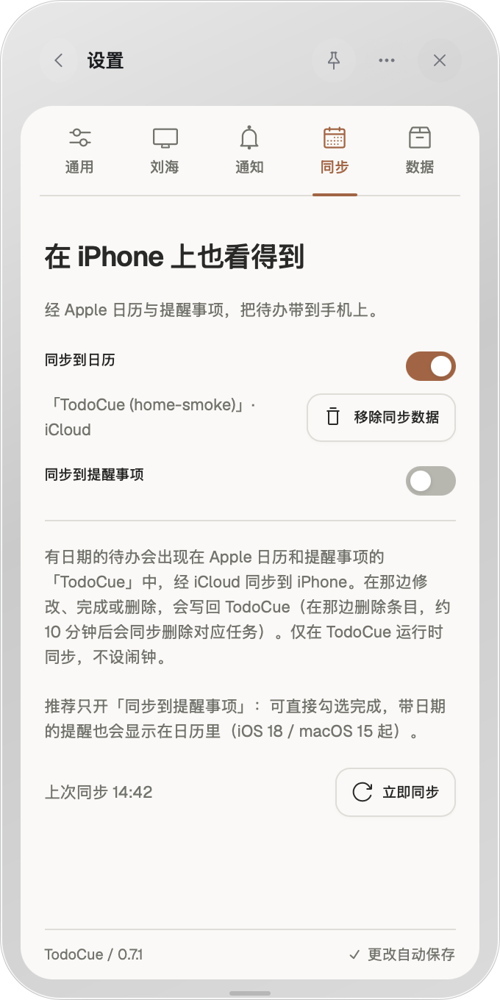

# Apple 同步接入通用版：验证记录（2026-10-20）

分支 `feat/desktop-apple-sync`，基于 `main` `a1e37d7`（v0.7.1）。设计见 [Apple 同步](../../apple-sync.md)。

## 自动检查

- `npm run check`：Vitest 369 项、release 测试、冒烟、release:check 通过。
- `npm run desktop:check`：TypeScript / Vite 构建，宿主 Rust 测试 89 项、通知 Rust 测试 5 项通过。新增的 `apple_sync` 测试包括用 shell 脚本冒充辅助程序的往返转发。
- `swift test --package-path apps/macos`：286 项，跳过 4 项（与 CI 基线一致），0 失败。其中 `AppleSyncKitTests` 36 项：原有 25 项控制器测试，加上接管与暂停的场景测试，以及辅助程序协议测试。
- 受控回归：把接管保护换回「整轮恢复、按轮次记客户端」的写法，以下三项测试会失败：iCloud 短暂读空后出现 20 条（应为 10 条）；某个通道暂时没有权限并重启后，任务被删除；接管后找不到的条目跳过了 10 分钟宽限，立即解除关联。
- 本机跑过预览 CI 新增的「Bundle the Apple sync helper」步骤：两份签名都带日历 entitlement，`codesign --verify --deep --strict` 通过。

## 原生实测

为了不碰正式数据，测试版改用独立 identifier（`com.todocue.app.applesync-qa`），去掉 `todocue://` URL 注册，hardened runtime 加日历 entitlement 做 ad-hoc 签名。它通过 `open` 启动，连接隔离运行时（`TODOCUE_HOME` 为临时目录，端口 47851），刘海关闭。

- 辅助程序作为 App 的子进程启动，环境变量 `TODOCUE_HOME` 和语言正确。
- 用户在测试版中打开「同步到日历」，并在系统授权弹窗中点了允许（弹窗内容未截图）。之后，作为子进程的辅助程序获得了日历的完全访问权限，说明系统找到了 App 的用途说明。iCloud 中新建了「TodoCue (home-smoke)」日历，3 条带日期的任务各生成一个日程（全天 / 定时，30 分钟）。
- 真实数据的开关（`com.todocue.app` 中的 `appleRemindersSyncEnabled=1`、`appleCalendarSyncEnabled=0`）在测试前后保持不变。
- TodoCue → Apple：用 CLI 改标题，约 4 秒后日程更新，读回的快照是新标题。完成一条任务后，它的日程被删除，关联随之解除。

设置页的 6 种状态（未开启、只开提醒事项、两个都开且其中一个不在 iCloud、被拒绝或只有写入权限、出错、启动中），以及中英文两种语言，都在只替换 `bridge.js` 的浏览器测试台（`.ui-review/apple-sync-harness`，不入库）里核对过。

## 未验证

- Apple → TodoCue 方向（在日历里拖动、改时长、改标题；在提醒事项里勾选完成）尚未真机实测，只有单元测试覆盖。
- Developer ID 正式包：授权是否沿用旧 SwiftUI 版（同为 `com.todocue.app`），以及从 v0.5.3 的 36 条提醒事项关联接管，需要在正式签名包上验收。
- 「旧版运行时暂停」只有单元测试，没有在真机上同时开着旧版验证。
- Windows / Linux 不启动辅助程序。只审查了 `apple_sync.rs` 的代码，没有在这两个平台编译。
