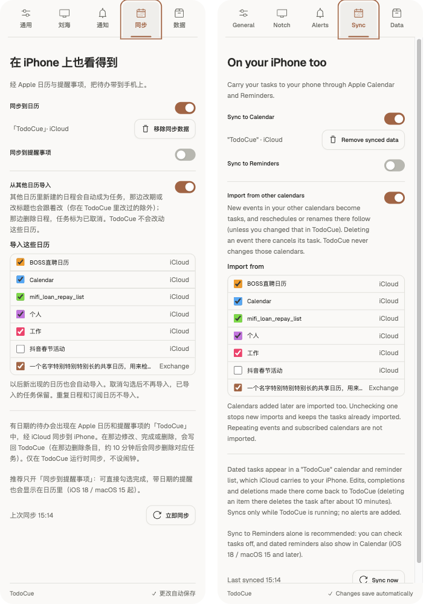

# 从其他日历导入：验证记录（2026-11-06）

分支 `feat/calendar-import`，基于 `main` `df79dce`（v0.9.2）。设计见 [Apple 同步 › 从其他日历导入](../../apple-sync.md#从其他日历导入)。

起因：用户在「BOSS直聘日历」（BOSS 直聘 App 自动建的 iCloud 日历）里收到的面试日程不会进 TodoCue。原因是同步只读自己的「TodoCue」日历。用户选定：默认导入全部日历、可逐个排除；那边删除日程时任务标为已取消。

## 自动检查

- `swift test --package-path apps/macos`：319 项，跳过 4 项（与 CI 基线一致），0 失败。新增 `CalendarImportTests` 19 项，以及辅助程序协议的新命令和状态测试。
- `npm run check`：Vitest 427 项、release 测试、冒烟、release:check 通过。
- `npm run desktop:check`：TypeScript / Vite 构建，宿主 Rust 测试 104 + 13 项通过（`apple_sync` 白名单转发 `setImportEnabled` / `setImportCalendar` 及 `calendar` 字段）。
- 受控回归：去掉「导入的任务不再镜像进 TodoCue 日历」的过滤，或让 `lastDesired` 不保留 TodoCue 自己的修改，各有测试失败（日历里出现两份；TodoCue 改过的标题被那边覆盖；移进 TodoCue 日历后出现第二个任务）。

## 独立审查

一个独立审查 Agent 只拿到需求和改动，报告了 5 个问题，逐条核对后都成立，已修复，并各有回归测试（把修复改回原写法时对应测试失败）：

1. 已完成 / 已删除任务的日程短暂读不到一轮，记录就被丢弃，下一轮重新导入。→ 关闭的记录保留到日程结束且任务不再是待办；标识符全变时按内容在同一日历里认回。
2. 改时间和拖进「TodoCue」日历在同一次保存里时，新时间被当成 TodoCue 的旧值改回。→ 新关联沿用导入的基线，只把 URL 视为 TodoCue 的改动。
3. 记录关闭后不可恢复：撤销完成、重新勾选日历后任务不再跟随；记录被丢弃后待办任务会被镜像进「TodoCue」日历。→ 任务又成待办且日程回到导入范围时恢复跟随；待办任务的记录不删除。被导入取消的任务在日程回来时重新打开。
4. 记录放在 `apple-sync.json` 里，回退 v0.5.3 保存时会丢，升级回来全部重新导入。→ 改存 `apple-calendar-import.json`。
5. 排除按日历标识符记，EventKit 完整同步换标识符后被排除的日历会整个导入。→ 同时记账户和名称，只转给从没见过的同名日历。
另外采纳了低置信度建议：熔断再按日历各算一次。

## 设置页

浏览器测试台（`.ui-review/apple-sync-harness`，只替换 `bridge.js`）核对了：开启并列出日历（含排除项、无颜色、超长名称截断）、中英文、开着但未授权、被拒绝、关闭、无可导入日历。点击复选框发出 `setImportCalendar`，开关发出 `setImportEnabled`。过程中发现日历列表用 `grid` 时最长一行撑宽了列、账户名被裁，已改为纵向 flex。

## 真机（EventKit）

这一轮在独立审查的修复之前进行；之后只改了规划和控制器逻辑，EventKit 读取部分（`EventKitBridge.swift`）没有再动，修复由上面的单元测试覆盖。辅助程序（debug 构建）单独打包为 `com.todocue.app.applesync-qa`，经 `open --stdin/--stdout --env TODOCUE_HOME=…` 启动，连接端口 47861 上的临时 runtime。镜像开关保持关闭，只开导入。用户在系统弹窗里允许了日历访问。

- 列出的日历：BOSS直聘日历、Calendar（两个同名 iCloud 日历）、mifi_loan_repay_list、个人、妈妈生日、工作、抖音春节活动。没有列出：「TodoCue」「TodoCue (home-smoke)」、生日、Facebook Birthdays、Found in Mail、Found in Natural Language、Scheduled Reminders。
- 导入 1 条：17:30 的面试，标题、`scheduledAt`、备注（含面试链接）正确。16:00 那场在日历里只有 5 秒时长，测试时已结束，按规则不导入。BOSS 直聘写入的日程都是 5 秒，所以不带 `estimateMinutes`。
- 再跑两轮：仍只有 1 个任务。排除「BOSS直聘日历」：导入记录关闭，任务保留为待办。重新勾选：不重复导入。
- 真实「TodoCue」日历条目数与最后修改时间不变；`com.todocue.app` 偏好未变；测试偏好域、临时 runtime 和辅助程序已清理。

## 未验证

- 在原日历里改期 / 改标题后任务跟随、删除日程 10 分钟后任务被取消、会议邀请被取消：只有单元测试覆盖。没有为此改动用户的真实日历。
- 正式签名包里的辅助程序（作为 TodoCue.app 子进程）：权限沿用 `com.todocue.app` 的日历授权，需在打包后的正式 App 上确认。
- Exchange / Google 等非 iCloud 账户的日历、Siri 建议日历在其他机器上的表现：本机没有这类账户。
