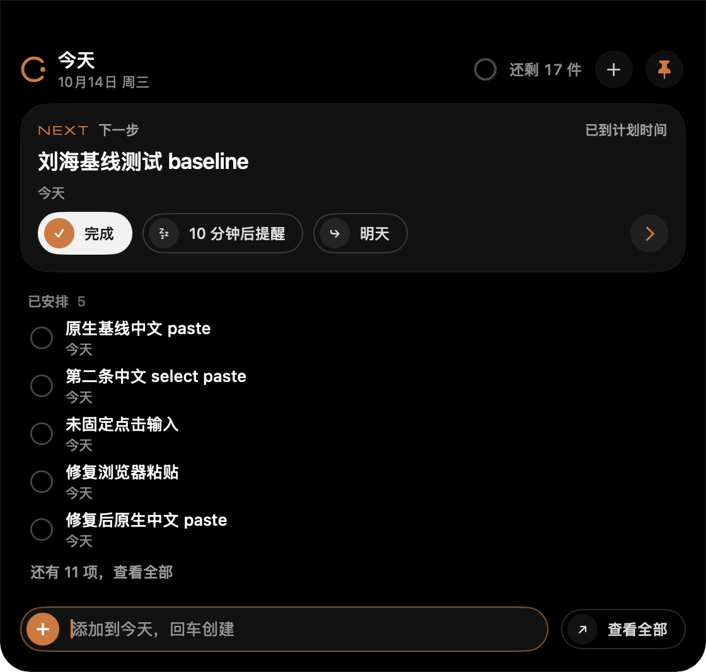
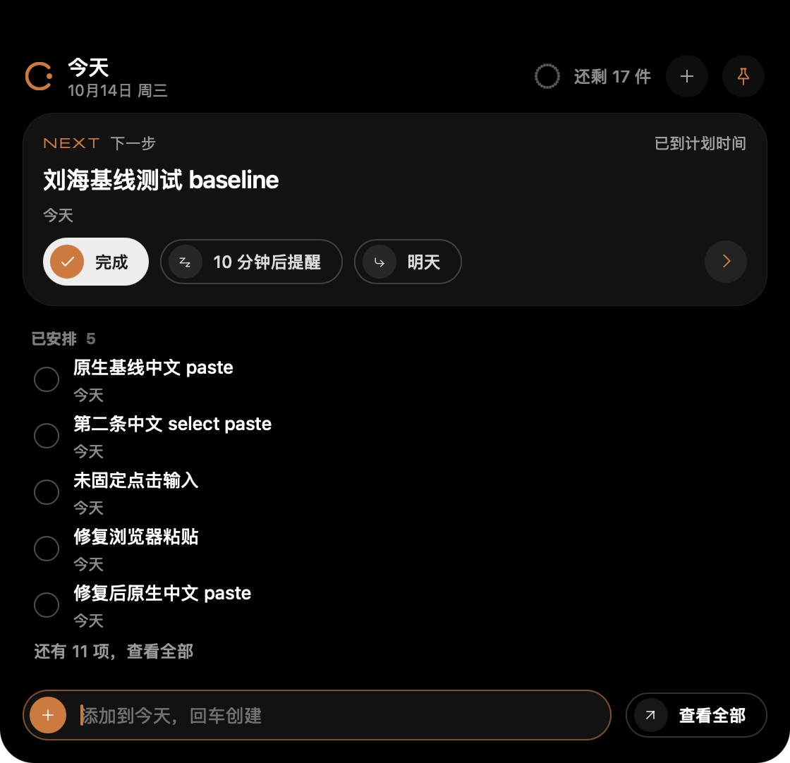

# 桌面刘海输入与 Dial 对照记录

2026-10-14，Apple Silicon / macOS 26。继续分支 `codex/desktop-native-ui-fixes` 从交接提交 `2bf7349` 建立；任务引擎、API 和数据库契约未修改。所有交互使用隔离 `TODOCUE_HOME=/tmp/todocue-desktop-native-ui-fixes-20261014`，运行时为 47832，浏览器为 5173。

## 触发条件与修复

| 触发条件 | 问题与修复 | 验证边界 |
| --- | --- | --- |
| 悬停展开后点击卡片/输入 | 宿主过去只在 pinned 时允许接收键盘，与 SwiftUI 在 expanded 时允许接收键盘不同；现按 expanded 设置 focusable，内部 pointer down 立即固定并取消离开计时。Windows 在 set_focus 前先移除 NOACTIVATE | macOS 原生输入通过；Windows 顺序修正未实机验证 |
| 点击收起条/加号后快速输入 | 单次 rAF 聚焦不能保证输入已挂载或宿主已激活。现挂载时用 layout effect 聚焦，宿主 Focused(true) 和尺寸完成回执补偿焦点；收起时取消待处理请求 | 最终原生包三轮快速展开、立即粘贴、双回车通过 |
| 快览收起/快览与提醒切换时继续使用旧 AX 元素 | Motion 退出期间控件仍在树中；窗口已经收小而旧输入仍可被自动化选中。退出层立即 inert/aria-hidden，行退出限定 120ms，退出层停止响应指针 | 最终原生 Esc 后 AX 树只剩收起条；早期同轮点击/粘贴丢字在最终包三轮中未再出现。不能据此断言所有早期失败都只有一个原因 |
| 保存中全选并粘贴相同标题 | 按字符串相等清草稿会清掉下一条同名输入；React 对值相同的 input 事件不触发 onChange。现在用 onInput 记录编辑代次，成功保存只清没有再编辑的草稿 | Ego Lite 延迟真实创建响应后再粘贴同名标题，返回后保留；独立模型回归通过 |
| 连续回车/保存失败重试 | 用同步锁阻止同一拍的重复提交，保留不确定保存的 idempotency key；成功后下一次同名创建使用新 key | 原生双回车 + API 读取确认每个测试标题只有一条；重试 identity 单测通过 |
| 收起期间保存返回 | 保存回调过去会无条件 focus；现在只在输入仍拥有焦点且快览仍展开时保留焦点 | Ego Lite 延迟真实响应、收起、放行响应，保持收起且 activeElement 为 BODY，重新打开下一条草稿仍在 |
| 点击提交箭头后继续输入 | 提交按钮保存中被替换/禁用，响应返回时再判断按钮归属已经太晚，焦点会留在正文。最终在按钮禁用前同步交回输入，并保留宿主窗口/WebView first responder 衔接；转向其他控件、Tab 或收起会取消后续补偿 | Ego Lite 刘海和主面板通过；延迟保存后点击固定按钮，返回仍保持按钮焦点。解锁后最终 macOS Preview 的刘海和主面板均通过箭头提交后直接继续输入；原生延迟保存中 Tab 转向查看全部，返回后仍保持按钮焦点 |
| 输入法确认 Enter / Esc | WebKit 的确认键可能 isComposing=false、keyCode=229；统一保护 composition 键，避免确认候选时创建或清草稿 | 单测与浏览器合成 229 键验证没有发 POST；真实候选窗口点击仍待验收 |

## 实测结果

| 入口 | 本轮结果 |
| --- | --- |
| Ego Lite 悬停/离开 | 约 207ms / 354ms；悬停后 activeElement 为 BODY，没有自动聚焦输入 |
| Ego Lite 编辑/外部点击 | 编辑期间离开保持展开；点击刘海外的页面区域收起；重新打开保留草稿 |
| Ego Lite 新提醒/SSE | 悬停中先延后展示，指针离开后入列；外部点击仅关闭快览，提醒堆叠和未提交草稿保留 |
| Ego Lite 错误反馈 | 注入创建 503：显示可见 alert，草稿保留，保存状态恢复。此项是前端失败路径测试，未制造真实运行时故障 |
| 原生 Preview 输入 | 英文输入、中文粘贴、⌘A 替换、连续回车、加号聚焦及 Esc 两阶段通过；解锁后最终包的刘海/主面板箭头提交均保持输入焦点，无需再次点击即可完整输入下一条英文草稿 |
| 原生 Preview 保存中切换焦点 | 暂停隔离运行时以延后真实创建响应；箭头提交后 Tab 转向查看全部，恢复运行时并保存成功后仍保持按钮焦点 |
| 原生 Preview 超时重试 | 隔离运行时暂停过久导致真实请求超时，错误可见且草稿保留；恢复后服务端已创建，使用原草稿重试成功，REST 核对仍只有一条任务 |
| 原生 Preview 快速连续操作 | 清理退出控件后，三轮“展开→立即粘贴→双回车”分别只增加一条；REST 读取确认三条标题各只有一个 todo |
| 原生 Preview 打开主面板 | 从刘海打开完整表单后快览收起；关闭面板再打开刘海，未提交草稿保留。此项验证应用内打开窗口路径，不代表物理鼠标点击外部窗口通过 |
| 首页布局 | 中英文 × 明暗 × 300/340/480/600，共 16 组无横向溢出、底部输入可见 |
| 表单/日历布局 | 中文浅色、减少动态效果、300/340/480/600 各四组无横向溢出，底部操作可见；表单中文/英文备注及换行输入通过。未覆盖这两页的完整主题/语言矩阵 |

早期解锁补测使用源码提交 `4927211` 的当时 Preview 包。刘海提交后直接输入 `next draft after arrow`，主面板直接输入 `panel next draft`，AX 树均显示完整文本且输入框聚焦；未提交草稿没有落入任务表。REST 读取确认“解锁后原生箭头提交回归”“原生保存中切换焦点回归”“解锁后原生面板箭头回归”“原生保存中 Tab 焦点验收”各只有一条 todo。

该轮延迟保存的 UTC 记录为：提交动作结束 `06:57:00.765`，Tab 结束 `06:57:00.869`，隔离运行时恢复 `06:57:03.185`。切换焦点发生在响应可返回之前；保存后输入清空，焦点仍在查看全部，见 [原生状态截图](notch-tab-after-save-macos.jpg)。本轮原生控件点击使用 AX action，键盘输入使用原生按键；这些结果不替代物理鼠标外部点击验收。

## 最终源码补测：`fdb8ce3`

进一步复测发现“宿主窗口已激活，WebView 尚无 first responder”和“按钮禁用后再恢复输入焦点”仍会影响最短间隔的输入。最终同时聚焦宿主窗口与 WebView，在提交箭头进入禁用状态前同步交回输入；刘海收起用原版的 first responder 释放/隐藏/重显顺序，不保留键盘占用。

最终包已验证主面板箭头后立即继续输入；主面板与刘海分别暂停隔离运行时、箭头后不重新点击输入直接 Cmd+A/粘贴下一条，恢复服务前后完整草稿和焦点均保留。REST 确认“最终即时箭头面板输入”“原生面板延迟箭头保存”“最终刘海双回车去重”“原生刘海延迟箭头保存”各只有一条，两个 pending 草稿均未写入数据库。见 [最终截图与 P1 / Windows 验证](../desktop-p1-ui/README.md)。

## 原版画面对照

两张图均来自实际运行的 macOS 窗口，使用同一隔离数据库、同一天和同一组 17 条任务，刘海宽 560 逻辑像素；没有用共享前端作为自己的视觉基准。对照 `NotchView.swift`、`NotchController.swift`、`DesignComponents.swift` 和 `DialKit.swift`。

本轮校准了 24pt 小表盘的恒定点径与剩余文字、下一步右侧说明、按钮图标圆盘、行间距/点击区、时间与行尾两项操作共享位置、36pt 胶囊输入和查看全部按钮、空状态以及减少动态效果。快览和提醒退出层在同一网格位置叠放，避免切换时测量把两层高度相加；初次 board 加载不触发完成波纹。保留原字体、原宿主窗口动画参数及现有任务数据流程。

| SwiftUI 原版 | React / Tauri macOS Preview |
| --- | --- |
|  |  |

字体/SF Symbols 与 SVG 的轮廓、系统抗锯齿以及自然文字高度仍有差异；没有宣称逐像素或逐帧一致。随后已补充四页实际窗口对照和 632 条布局测量，见 P1 记录；全部原生主题状态与连续动效逐帧对照仍需继续。

## 质量检查和限制

- 最新本地 `npm run check`：175 个 Vitest（25 文件）、21 个发布/打包脚本测试、CLI/MCP 冒烟、release check 通过。
- `npm run desktop:check`：TypeScript/Vite 构建、Rust 11+5 个测试通过；最终 macOS debug Preview 构建通过；SwiftUI / notifier 对照 App 构建通过。
- 本地只有 CLT，Swift 缺 XCTest，未写成本地通过；本轮 [Quality CI](https://github.com/NanmiCoder/TodoCue/actions/runs/38557490649) 使用 Xcode 26.2，Apple Silicon Swift 275（4 跳过）、Intel 275（11 跳过）均 0 失败。Intel VM GPU/opt-in 截图限制见 P1 记录。
- 本轮 [Desktop CI](https://github.com/NanmiCoder/TodoCue/actions/runs/38557490723) Windows x64/ARM64 实际 NSIS 构建、安装/CLI/MCP/计划任务/后台重启/重装恢复/卸载保留数据库全部通过；下载和报告见 P1 记录。Windows GUI/通知点击并未据此标成通过。
- 原生坐标工具无法取得刘海窗口，其他应用定向 AX 操作没有可靠全局鼠标证据；因此不关闭真实外部点击、透明命中、拖选、输入法候选窗口、多屏/全屏/休眠验收项。临时诊断全部移除。
- 全部原生视觉/逐帧对照、Mac Intel Tauri 包、真实硬件刘海、EventKit 及正式客户端切换仍待后续；未合并、未发布正式版本。

## 下一次原生验收

1. 在最终 Preview 上实际悬停后点击输入/加号/收起条，直接输入中文和英文；鼠标拖选、⌘A、粘贴、连续回车及保存中继续输入下一条。
2. 保留草稿并固定快览，物理鼠标点击另一应用、桌面或已打开的主面板；确认收起和重新展开后的草稿。输入法候选窗口点击必须同时验证，不能将失焦直接解释为外部点击。
3. 提醒到达、6 秒收拢、外部点击、折叠/展开交叉执行，确认提醒不丢、不抢键盘；真实鼠标离开时约 350ms 收起，悬停约 200ms 展开。
4. Windows 按交接文档继续 GUI/通知/窗口和干净机验收；已有对应架构完整构建、安装/后台冒烟及完整 Xcode Swift CI，不重复当作尚未启动的任务。
