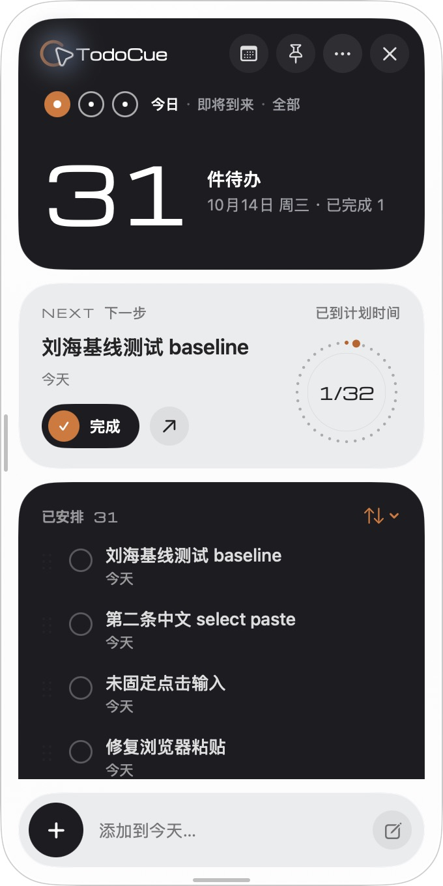
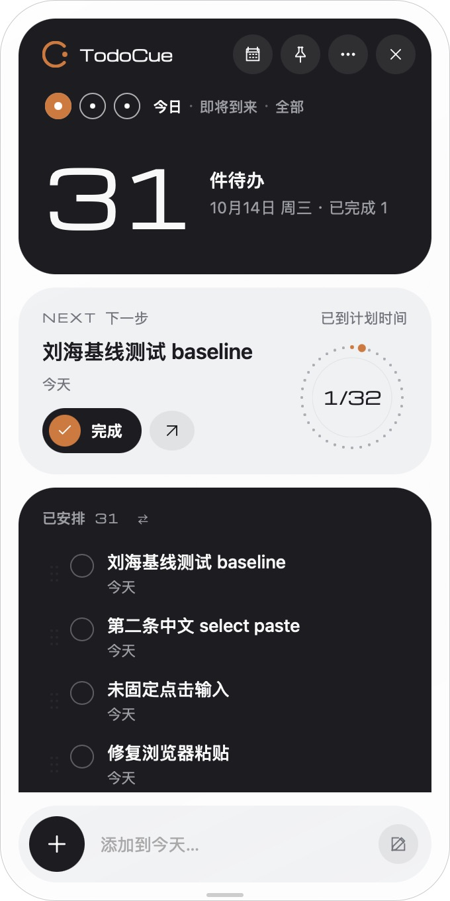
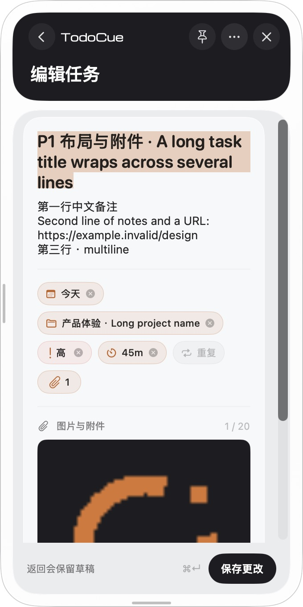
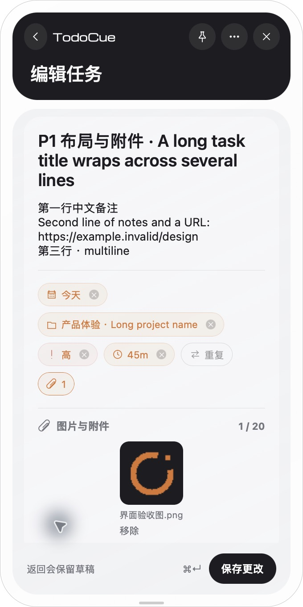
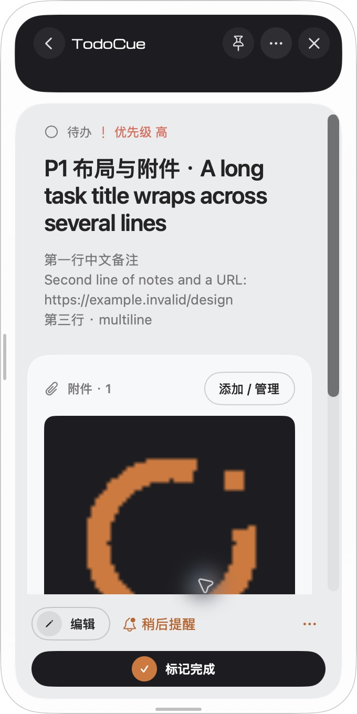
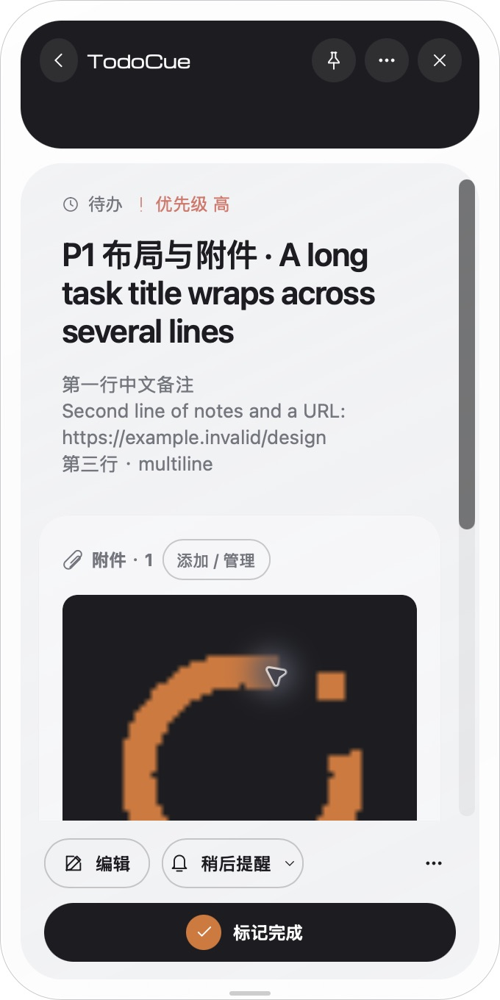
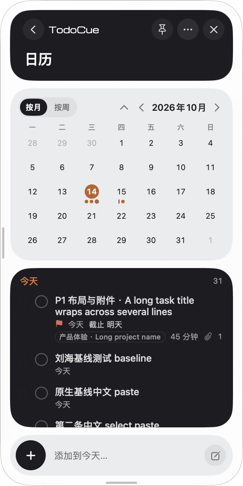
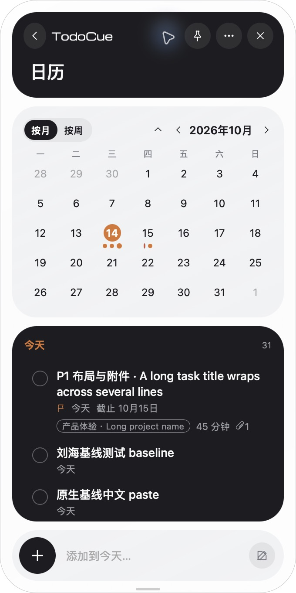

# 共享 UI 校准与 Windows 安装验证

2026-10-14。UI 代码基准 `fdb8ce3`，分支 `codex/desktop-native-ui-fixes`，原交接提交 `2bf7349`。[草稿 PR #17](https://github.com/NanmiCoder/TodoCue/pull/17) 的目标分支是 `codex/desktop-migration-handoff`。没有合并主分支、升级版本或发布正式包。

本机 Apple Silicon / macOS 26；全部本地 UI 操作使用 `TODOCUE_HOME=/tmp/todocue-desktop-native-ui-fixes-20261014`，运行时端口 47832，Ego Lite 端口 5173。没有使用个人生产数据库。报告只保存布局/行为测量和测试文本，不保存连接 token 或数据库。

## 按 SwiftUI 修正的体验

以实际运行的原客户端及 `TaskFormView.swift`、`TaskDetailView.swift`、`CalendarView.swift`、`DialKit.swift`、`DesignComponents.swift`、`NotchView.swift` 为基准，继续使用 React/Tauri 和原任务契约。

| 部分 | 修正后的行为 |
| --- | --- |
| 原生焦点 | 面板显示/固定时同时激活宿主窗口和 WebView first responder；刘海收起释放 first responder。箭头提交在按钮进入禁用状态前同步把焦点交回输入框，随后尊重 Tab、其他控件和收起操作 |
| 表单输入 | 19pt 标题自动增长至 2–4 行，13pt 备注至 2–6 行，重新排版响应窗口宽度和字体加载；Cmd/Ctrl+Enter 不重复提交，composition/229 不保存 |
| 草稿 | 空白完整表单默认未安排；继续输入恢复草稿；有快速输入时创建新草稿；从日历新建时使用选中日期。提交中编辑和附件移除继续按原保存会话处理 |
| 属性与附件 | 日期、项目、优先级、耗时和附件数呈现当前值及淡色描边，各自可清除；已创建任务不改重复规则。图片按原版列数组成缩略图，文件整行显示；预览支持焦点约束、Esc 返回及焦点恢复 |
| 日历 | 月/周/折叠、前后导航与点击标题回今天；中文周一开头，英文按区域周规则。待办计划、已完成历史和截止标记分别计算；历史默认折叠，待生成占位不提供任务操作 |
| Dial | 数字按位滚动并保留未变前缀，表盘面和指针随同一连续进度更新，只有完成计数实际增加触发波纹；完成反馈等待 420ms 再写入 |
| 系统偏好 | 减少动态效果实时订阅媒体变化，不重挂编辑页面；关闭位移/缩放/布局运动，保留短淡入。减少透明度使用实色背景；移除 hover 直接位移的遗漏 |

## 实测通过

| 检查 | 范围与证据 |
| --- | --- |
| 页面布局 | [448 条测量](layout-pages.json)：中/英文 × 明/暗 × 正常/减少动效 × 300/340/480/600 宽 × 14 个页面状态，高 680。覆盖今日、即将到来、全部、详情、编辑/长表单、日期弹层、月/周/折叠日历、已完成、周期列表/表单、设置 |
| 附件与表单布局 | [160 条测量](layout-attachments.json)：同一完整矩阵 × 详情、编辑、长表单、日期弹层、图片预览。实际媒体匹配、无横向溢出、底部操作可见；预览 Esc 返回表单 |
| 最小高度 | [24 条测量](layout-short-window.json)：中/英文 × 300/600 宽 × 今日、详情、表单、弹层、短窗口日历、周日历，高 360。滚动后可操作内容和底部按钮可见 |
| 动态偏好/冲突/输入 | [真实行为结果](behavior.json)：编辑中切换深色、减少动效及减少透明度后标题保留，背景为 `rgb(42,44,48)`，属性弹层位移 0/缩放 1；合成 229 键产生 0 次写入。外部真实 PATCH 制造版本冲突，保存显示 reload 操作且保留标题；读取最新版本通过 |
| 箭头提交继续输入 | 浏览器延后真实创建响应，未重新点击输入就全选并输入下一条，返回后文本完整；最初测试用了 macOS 的 Control+A（移至行首），改用 ControlOrMeta+A 后通过。此项为测试快捷键修正 |
| macOS 面板/刘海 | 最终 `fdb8ce3` Preview 在箭头后直接输入通过；分别暂停隔离服务，箭头后不点击输入直接 Cmd+A/粘贴下一条，响应前后草稿均完整且聚焦。REST 确认已提交标题各只有一条，下一条未提交草稿各为 0 条 |
| macOS 完整表单/附件 | 原生填写并创建真实任务、附件缩略图与属性值通过；打开图片预览，Esc 回到表单通过。输入、粘贴、双回车去重、两阶段 Esc 和原生保存中 Tab 的更早证据见 [P0 记录](../desktop-native-ui-fixes/README.md) |

448 条矩阵在 `1e75981` 开始，日历语义修正在期间加入；160 条矩阵使用 `c7fca25`，24 条短窗口与最终行为复测使用 `fdb8ce3`。后续焦点和实时偏好变更未改变这些页面的布局；这里不把测量次数等同于原生页面逐像素验收。

完成写入时间实测约 423ms、真实响应约 476ms。[逐帧采样](motion-sampling-inconclusive.json) 约每秒才取得一帧，只能确认最终数字/表盘状态与延后写入，**连续动画的逐帧一致性尚未验证**。不能把这组低频采样标成动效通过。

## 原版与 Preview 实际窗口

以下来自实际 SwiftUI/AppKit 与 Tauri/WebView 窗口，同一隔离数据库、同一天、340×680 逻辑尺寸，截图为 680×1360。截图时共有 31 条待办、1 条完成；后续输入回归又增加了测试任务，因此下面的焦点截图计数不同。原版编辑标题的橙色区域是文本选择状态。Tauri 截图代码 `dd78a0d`，最终 `fdb8ce3` 焦点修正未改变布局。

| 页面 | SwiftUI 原版 | Tauri Preview |
| --- | --- | --- |
| 首页 |  |  |
| 表单 |  |  |
| 详情 |  |  |
| 日历 |  |  |

焦点证据：[面板立即继续输入](panel-immediate-input-macos.jpg)、[面板延迟响应后草稿](panel-pending-draft-macos.jpg)、[刘海延迟响应后草稿](notch-pending-draft-macos.jpg)。另有 [英文深色图片预览](attachment-preview-en-dark.png)。

字体渲染、SF Symbols/SVG、系统玻璃和原生 Quick Look 与共享图片预览仍有平台差异；没有宣称逐像素相同。当前原生对照覆盖以上四页和 P0 刘海，不能代替所有主题/语言/状态的原生对照。

## Windows 两种架构：实际安装包通过

代码 `7ad1b95` 的 [Desktop preview CI](https://github.com/NanmiCoder/TodoCue/actions/runs/38571147367) 全部通过。x64 使用 Windows Server 2025 Datacenter 10.0.26100 的 `windows-latest` runner；ARM64 使用 Microsoft Windows 11 的 `windows-11-arm` runner。不是 Windows 10 桌面 GUI 验收。

两种架构分别构建真正的 NSIS 包，并用包内 Node/CLI/SQLite 在中文含空格的隔离目录完成七组检查：

1. 静默安装，文件齐全、Node 架构匹配、原生 SQLite 实际执行 SQL。
2. 当前用户计划任务启动自定义目录运行时，CLI shim 指向安装后的 runtime。
3. 包内 CLI 和已安装 shim 创建、读取附件，幂等重试返回同一任务。
4. 已安装 MCP stdio initialize、发现工具、读取任务，stdin EOF 正常退出。
5. 后台停止/启动后任务和附件保留。
6. 静默重装停止并恢复已登记自定义目录运行时；只轮询健康，不由测试主动启动掩盖恢复失败。
7. 卸载清理服务、CLI、受管理 PATH，保留 SQLite 数据库。

| 架构 | 安装包及 SHA-256 产物 | 安装冒烟 JSON |
| --- | --- | --- |
| x64 | [预览产物](https://github.com/NanmiCoder/TodoCue/actions/runs/38571147367/artifacts/11898134377) | [七组检查报告](https://github.com/NanmiCoder/TodoCue/actions/runs/38571147367/artifacts/11898009362) |
| ARM64 | [预览产物](https://github.com/NanmiCoder/TodoCue/actions/runs/38571147367/artifacts/11899180283) | [七组检查报告](https://github.com/NanmiCoder/TodoCue/actions/runs/38571147367/artifacts/11898418361) |

这是 GitHub Actions 临时预览产物，需要仓库访问权限，按 artifact 保留策略过期；不是正式 Release。可重新触发 workflow 重建。

CI 暴露并修复了通知助手平台路径、动态导入文件 URL、Cargo CRLF、图标格式、测试时区、NSIS 不携带工作区 junction、模块搬迁改变 runtimeRoot、数值 SID 的权限授权，以及升级任务已启动但健康尚未就绪的验收竞态。工作区入口改为普通目录和转发文件，保留原模块 URL；搬迁后导入回归通过。数值 SID 按 [Microsoft icacls 文档](https://learn.microsoft.com/en-us/windows-server/administration/windows-commands/icacls) 加 `*` 前缀。

## 质量检查与剩余边界

- 本地 `npm run check`：25 文件 / 175 个 Vitest、24 个脚本测试、CLI/MCP 冒烟和 release check 通过；版本仍为 0.5.3。
- `desktop:check`：前端构建及 Rust 11+5 测试通过；最终源码 macOS debug Preview 包构建通过。Windows 的 Rust 测试额外运行 3 个平台测试，两种架构都通过。
- [Quality gates](https://github.com/NanmiCoder/TodoCue/actions/runs/38571147359)：Linux 完整检查通过；完整 Xcode 26.2 的 Swift Apple Silicon 275 个测试（4 跳过）、Intel 275 个（11 跳过）均 0 失败。Intel VM 无可用 GPU，跳过原生动画窗口测试；截图测试为显式 opt-in。本地只有 CLT，缺 XCTest 的限制没有被写成通过。
- Windows 的 Vitest 为 174 通过/1 跳过，脚本为 19 通过/5 跳过，平台专属跳过与本地数字不同；不能把跨架构构建写成全部 GUI 行为通过。
- macOS AX 控件动作与原生键盘已验证；物理鼠标外部点击、拖选、候选窗口、透明命中、原生悬停时序、多屏/全屏/休眠仍未完成。原生坐标工具无法取得刘海可点击窗口；其他应用定向操作没有可靠全局鼠标证据。
- Windows GUI、通知点击冷/热启动、离线 WebView2 的干净机安装、多屏/DPI/任务栏、IME、全屏/休眠及提醒并发的实机行为未验证。
- macOS Intel 的 Tauri 包、真实硬件刘海、EventKit 桥接、偏好导入和生产客户端切换仍是后续迁移项。

下一次验证先跑 [交接清单](../../desktop-handoff.md) 中这些实机项；不重复已通过的打包修复，也不以缺设备要求重写任务引擎、API 或数据库。

## 打包下载的后续稳定性修正

仅文档变更的 `b235561` 复跑中，ARM64 的编译/测试通过，但下载 Microsoft WebView2 时 `failed to bundle project: Peer disconnected`，未进入安装冒烟。此故障与更早的 ARM64 下载断连重复，不能把该次失败隐藏成安装通过。原 `fdb8ce3` 的两个完整成功记录和产物仍有效。

`runWindowsBundler` 现在只对包含该 Tauri 打包阶段错误的传输断连最多尝试三次，间隔 2/4 秒；编译、校验和、NSIS 等确定性错误立即失败，耗尽仍返回原退出状态。三个真实子进程回归验证“断连后成功产物”“确定性错误不重试”“反复断连限次失败”。本地完整检查仍为 175 个 Vitest，脚本增至 24 个。最终代码 `7ad1b95` 的 [Desktop CI](https://github.com/NanmiCoder/TodoCue/actions/runs/38571147367) 与 [Quality CI](https://github.com/NanmiCoder/TodoCue/actions/runs/38571147359) 均已全部通过。Windows 两种架构各七组实际安装冒烟再次通过，脚本为 19 通过/5 跳过；具体 job、产物和七组结果保存于 [最终代码 CI 摘要](ci-code-7ad1b95.json)。

同时淘汰 CI 中仅 214 字节的旧 Rust 缓存，使用 v2 key，并要求 Rust 检查成功后才保存，避免构建前失败留下空缓存。截图扩展名已与原生 JPEG / 浏览器 PNG 实际格式匹配，原像素未改变。

## 2026-10-14：三路独立代码审查

审查对象 `09b21da`；该提交的六个 CI job 均通过（[Desktop](https://github.com/NanmiCoder/TodoCue/actions/runs/38573901586)、[Quality](https://github.com/NanmiCoder/TodoCue/actions/runs/38573901600)）。构建/布局通过不代表所有行为正确。本次分别启动原生交互、SwiftUI 体验对照、安装/后台分发三个独立 subagent，只读审查整套迁移代码及本轮 diff；主代理再复核代码并用 Ego Lite 对真实 API 重现。没有将发现的问题改写成已修复。

结论：Windows x64/ARM64 有受控预览安装包条件，**尚不具备迁移后共享客户端的正式双平台分发条件，尚未完全复刻 SwiftUI**。共享 macOS 的 Tauri 包没有 runtime resources，自动 bootstrap 只有 Windows 分支，仍需外部运行时；Intel 共享包、正式签名/公证、EventKit、偏好迁移和生产切换未完成。原 SwiftUI macOS 正式客户端与共享客户端应分别判断。

本次主代理使用新的隔离 `TODOCUE_HOME=/tmp/todocue-review-20261014`、47832/5173，未运行安装器或操作个人库。复现数据与结果见 [JSON](review-behavior-09b21da.json)、[日历](review-calendar-09b21da.png)、[图片网格](review-gallery-09b21da.png)、[固定按钮](review-pin-09b21da.png)。图片中的 Ego 工具标识不是产品内容。

| 优先级 | 问题、触发与影响 | 当前代码 / 证据边界 |
| --- | --- | --- |
| P1 | 自定义 home 的已安装 CLI 没有绑定所属目录。新终端无 TODOCUE_HOME，执行 PATH 上的 todocue 会读默认 .todocue，可能操作另一库；现有安装测试每次显式 --home，掩盖普通调用 | [cli.rs](../../../apps/desktop/src-tauri/src/bin/cli.rs#L19)、[bootstrap.ts](../../../packages/cli/src/bootstrap.ts#L64)。独立代理在临时目录编译原 shim，用实际 resolveHome 做子进程探针确认回落；未操作真实 Windows 用户库 |
| P1 | GUI bootstrap 重建 spec 时丢失用户安装的 port，完整 JSON 比较触发重装，覆盖 --port 47832 为默认 47831；另一 home 占用默认端口时启动失败 | [bootstrap.ts](../../../packages/cli/src/bootstrap.ts#L63)。代码确定路径，尚未做 Windows 故障注入；应保留旧 port 并覆盖 bootstrap 回归 |
| P1 | 日历翻页只改 anchor，selected / 快速添加目标不变。实测从 Oct 2026 翻到 Nov 2026，议程仍 Today，真实新任务 scheduledDate=2026-10-14。周议程点击也没有更新 selected | [pages.tsx](../../../apps/desktop/src/pages.tsx#L195)、[周议程](../../../apps/desktop/src/pages.tsx#L326)。月翻页和实际创建已动态确认；周选择为源代码对照。Swift AppModel.stepCalendar 同步移动选择 |
| P1 | 完整表单标题普通 Return 直接 save，项目弹层普通 Return 又通过表单默认提交创建任务；原版标题只结束编辑，项目只确认属性，保存使用 Cmd+Return | [Composer.tsx](../../../apps/desktop/src/Composer.tsx#L298)、[项目输入](../../../apps/desktop/src/Composer.tsx#L445)。两条真实创建请求和任务均已确认；不是合成 IME 键测试 |
| P2 | 悬停展开后首次点击 Pin 无效：捕获阶段先 setPinned(true)，click 再按 !pinned 反转。实测前后 aria-pressed 都 false，指针离开后快览收起 | [Notch.tsx](../../../apps/desktop/src/Notch.tsx#L514)、[Pin click](../../../apps/desktop/src/Notch.tsx#L569)。真实 Ego hover/mouse click 复现；不代替原生物理外部点击验收 |
| P2 | 单张已有图片没有撑满表单网格，旧 align-items:center 使 column flex 内网格收缩。实测容器255px，网格86.6px；原生配对图也能看到约71pt的小图而非原版整列图 | [style.css](../../../apps/desktop/src/style.css#L1552)、[后续覆盖](../../../apps/desktop/src/style.css#L2032)。截图与 DOM computed geometry 确认 |
| P2 | 同一 Windows home 的正斜杠、尾分隔符和尾部点得到不同 Rust ID，Node path.resolve 后 ID 相同；单实例、Run 项和通知登记不一致，可重复开窗或留下启动项 | [windows_home.rs](../../../apps/desktop/src-tauri/src/windows_home.rs#L6)、[windows-integration.ts](../../../packages/cli/src/windows-integration.ts#L15)。独立代理及主代理词法 hash 探针确认；完整通知/卸载系统路径未实机复验 |
| P2 | POSTINSTALL 只 Pop 启动服务的退出码，不检查失败；升级已停旧服务后恢复失败，安装器仍完成，后台提醒离线 | [windows-hooks.nsh](../../../apps/desktop/src-tauri/windows-hooks.nsh#L15)。代码确定异常路径，未做真实计划任务故障注入 |
| P2 | 第四条新任务提醒变成不可操作的 +1：新 cue 尾部追加并设置 featuredKey，但渲染只取前三条；原版保留 featured，即使位于前三条之外 | [Notch.tsx](../../../apps/desktop/src/Notch.tsx#L865)、[NotchStackView.swift](../../../apps/macos/Sources/TodoCue/NotchStackView.swift#L13)。静态数据流确认，未新增原生并发提醒复测 |
| P2 | 当天精确 dueAt 已过，详情仍显示 To do，元数据只按日期判断，不呈现原版红色逾期；日历也缺相应日期状态 | [Detail.tsx](../../../apps/desktop/src/Detail.tsx#L130)、[metadata.tsx](../../../apps/desktop/src/metadata.tsx#L64)。Swift/React 逻辑确认，未新增实时逾期 UI 测试 |
| P2 | 普通查看面板与请求编辑统一调用宿主/WebView focus；macOS Tao 会激活应用，偏离原版仅编辑请求取 key 的行为 | [lib.rs](../../../apps/desktop/src-tauri/src/lib.rs#L341)、[SidePanelController.swift](../../../apps/macos/Sources/TodoCue/SidePanelController.swift#L165)。代码确定激活调用，另一应用插入点的原生复验待完成 |
| P2 | 托盘/菜单栏禁用左击菜单，却没有左击处理；禁用刘海且无快捷键时，左击图标无效，只能右击菜单。原版普通点击即可打开菜单 | [lib.rs](../../../apps/desktop/src-tauri/src/lib.rs#L825)。本地 tray-icon 实现与 Swift 原码确认，未新增系统托盘实测 |
| P3 | 详情头部高度和属性文字颜色仍有静态偏差：87pt detail header 下移内容；active chip 整行橙色，原版仅图标着色 | [style.css](../../../apps/desktop/src/style.css#L2011)、[active chip](../../../apps/desktop/src/style.css#L1505)。配对截图/样式对照，不能归入字体或玻璃差异 |

以上问题在本次审查时均未修复。优先清除四项 P1，再回归 P2 交互与安装故障路径；修复后重新验证，不能把本页旧 CI 或布局计数当成修复验收。悬停展开可能抢同应用编辑焦点的另一候选，仍需原生动态证据，本次未列为确认 bug。逐帧、候选窗口、物理外部点击和 Windows GUI/DPI/多屏仍保持未验证。
