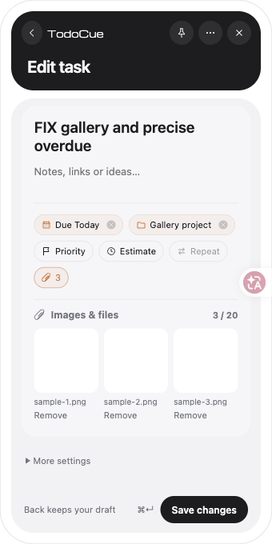
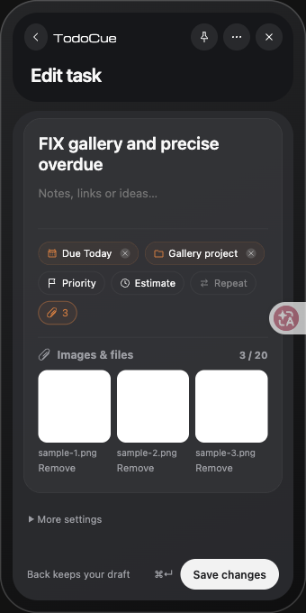
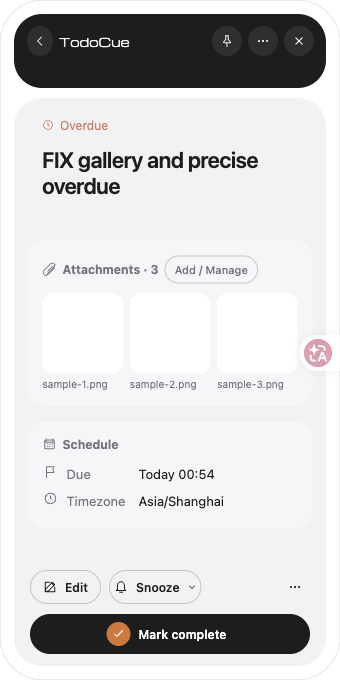
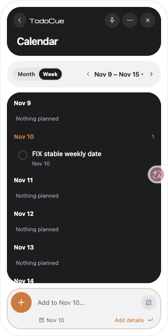
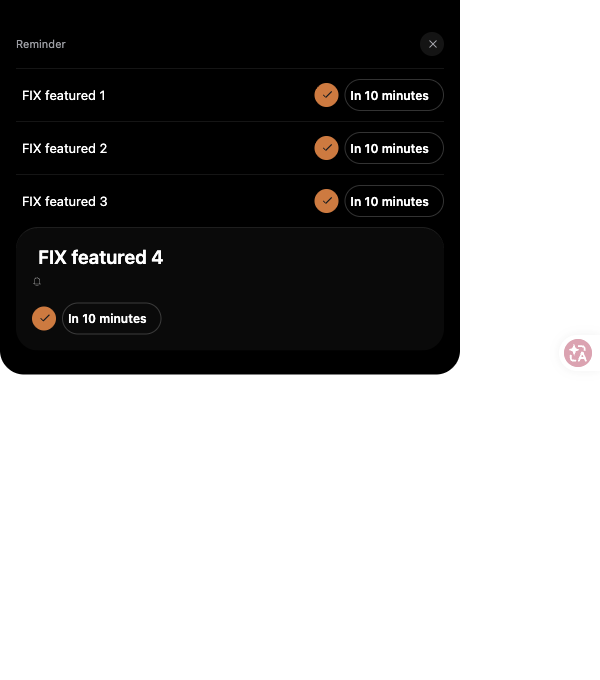

# 桌面独立审查修复与回归

2026-10-15。修复提交 `193292e`、`50762d4`，继续使用 `codex/desktop-native-ui-fixes` 和 [草稿 PR #17](https://github.com/NanmiCoder/TodoCue/pull/17)，目标为 `codex/desktop-migration-handoff`。不合并主分支、不升级版本、不发布正式包。

全部本机操作使用 `TODOCUE_HOME=/tmp/todocue-review-fixes-20261015`，运行时 47832、Vite 5173。Ego Lite TaskSpace 24 覆盖本轮浏览器复测；原生使用此目录启动的 TodoCue Preview。没有读取个人生产数据库，证据不含连接 token。

## 修复范围与证据

[原独立审查的13项发现](../desktop-p1-ui/README.md#2026-10-14三路独立代码审查)保留作为历史失败证据。三个独立代理继续分别审查分发、原生交互、SwiftUI 对照；主代理实现并复测，代理补充回归及再次复审。

| 项目 | 修复 | 已验证 / 验证边界 |
| --- | --- | --- |
| R1 安装 CLI 所属 home | 仅 pointer shim 且环境未指定时设置所属目录；Commander 显式 `--home` / `--home=` 仍优先 | 实际编译 shim 的9种子进程行为通过；Windows 安装后无参数 context/add/MCP 两架构通过 |
| R2 bootstrap 端口 | 保留旧 manifest 的合法端口0–65535，更新新安装路径 | 12项 bootstrap 回归通过，包括非默认端口、0、损坏配置和健康不重装；两架构真实安装端口保留通过 |
| R3 日历选择和添加日期 | 月翻按 anchor 日号夹取并同步 selection，周翻保留星期；周日标题和空白可选择；切 span 清展开并定位当前选择 | [真实创建](calendar-save.json)分别写入2026-11-15与2026-11-10；9项月份/跨年/周/日期桶回归通过 |
| R4 完整表单 Return | 标题普通 Return 结束编辑；Shift/Option Return 换行；项目/预估临时属性值由 Return/Done 确认；Cmd/Ctrl Return 保存；候选键不截断 | [真实请求及数据](form.json)：标题/项目/预估普通 Return 零 POST，Cmd Return 单次 POST；原生标题 Return 不创建、Cmd Return 创建通过。真实IME候选仍待验收 |
| R5 Pin 首击 | 显式 Pin 控件不参与自动固定的捕获阶段 | [Ego真实点击](pin.json) false→true，离开后保留；取消固定后离开收起 |
| R6 附件网格 | gallery 与网格伸展到父宽度 | [测量](gallery.json)：父/网格均255px，旧值86.6px；单图255px；300/340/600宽、明暗、最小360高共6组无溢出且撑满，见[布局](gallery-layout.json) |
| R7 Windows home 标识 | Rust 按 Node 词法规则处理分隔符、点段、根及大小写；启动目录统一绝对化，不要求目录已存在 | drive/UNC/device golden通过；x64不存在目录 resolve_home 回归通过；两架构完整结果见下文 |
| R8 安装恢复失败 | NSIS 对非零/error/timeout 明确失败，静默模式不等弹框；后台仅健康后清 resume 标记 | mock回归包括 /Run拒绝与认可但不健康，保留数据和重试；两架构实际安装故障注入及健康重试通过 |
| R9 第四 featured / hover | 保留前三行顺序并额外展示 featured；更多打开含全部提醒的快览；单条 hover 独立，离开恢复；到达寿命在hover/操作期间暂停 | [真实四条提醒](cues.json)前三行不动、第四全卡；[休息/更多](cue-rest-more.json)验证收回三行并可打开全部；periodic认领容量仍3，现有receipt回退与新增容量测试通过 |
| R10 精确逾期 | todo的dueAt严格小于now，全天dueDate仅小于today；详情/元信息/日历标红 | [详情](detail.json) Overdue；7项毫秒/时区/全天/历史状态回归通过；使用已有30秒刷新更新打开的页面 |
| R11 普通查看与编辑焦点 | Mac被动orderFrontRegardless；Win通过Tauri维护可见状态，线程CBT仅拦被动panel激活；明确编辑解除保护并保留宿主/WebView双焦点 | 原生NewTask/编辑、刘海输入与保存中继续输入通过；Win32激活回归x64/ARM64均通过，系统前台/WebView GUI仍待实机 |
| R12 托盘左击 | 恢复左击菜单，沿用既有菜单动作 | 源码复审和构建；系统托盘左击仍保留GUI验收项 |
| R13 详情头部/属性色 | 详情min-height74，属性文字正常正文色，仅图标强调色 | [测量](detail.json)、[颜色](gallery.json)与截图通过；保持离线内容可扩展 |

切换日历 span 会把 anchor 定位到当前 selection，以保证新范围包含已选择日期；这是对原版切 span 边界的明确改善。月份翻页仍按原版 anchor 夹取，不维持隐藏的31日游标。

另修复了本轮原生验证发现的快捷键录制控件未取得DOM焦点，以及独立复审发现的跨页面Cmd/Ctrl+F在输入挂载前聚焦。原生录制成功、[快速输入焦点](quick-focus.json)在活跃页且不在inert退出层；最终50762d4原生从表单Cmd+F也直接聚焦快速输入。外部收起同时清除hover ref/state，避免提醒计时永久暂停。

## 本机实测

- `npm run check`：208项Vitest / 29文件、34项脚本测试，CLI/MCP/SQLite重启与release check全部通过。新增33项Vitest和10项脚本计数包括父测试。
- `npm run desktop:check`：前端构建与macOS Rust11+5通过；最终Preview debug app构建通过。
- 完整表单标题、项目、预估普通回车零创建，换行保留；Cmd Return只创建一次，项目trim与预估25写入SQLite。空属性Return保留弹层。
- 原生刘海立即输入/双回车只有一条，完整表单普通回车保持草稿；Cmd Return创建一条；从刘海打开新任务直接取得标题焦点。
- 暂停本轮隔离runtime后，面板箭头提交不再次点输入，直接键入下一段；保存中输入和first responder均保留，恢复后只保存原提交，编辑中的草稿保留。暂停只针对本轮PID，并已恢复。
- 通过原生Cmd+C/Cmd+V追加测试文本，确认系统粘贴进入当前输入；CUA直接paste受远程剪贴板干扰的尝试不当作产品粘贴失败，也不当作通过。
- [原生任务核对](native-tasks.json)记录已创建标题；[原生表单](native-form.png)记录普通Return后仍保留未提交标题。没有保存数据库或连接文件。
- 本地 `swift test` 缺XCTest（只有CLT），明确未在本地通过；最新完整Xcode Swift Apple Silicon/Intel CI均通过。

浏览器在开发代码热更新期间重置页面的一次跨页测试不作为结果，稳定页面后重新操作并以实际scheduledDate断言。截图里的Ego标识属于验证工具。

## Windows与远程质量门

`193292e` 的 [Desktop CI](https://github.com/NanmiCoder/TodoCue/actions/runs/38603163534) 在x64新激活测试严格失败：NOACTIVATE + SW_SHOW仍激活窗口。这不是下载抖动，失败记录保留。`50762d4` 使用同一生产CBT保护重测，继续保持Tauri可见状态；不删除断言或跳过测试。

最新源码 `50762d4146b0f804ee6ae54f7958363c995e6503` 的六项CI均通过：

- [Quality CI](https://github.com/NanmiCoder/TodoCue/actions/runs/38604992687)：Linux完整检查；Swift Apple Silicon275（4跳过）、Intel275（11跳过），均0失败。Intel GPU及opt-in截图的限制保持原记录。
- [Desktop CI](https://github.com/NanmiCoder/TodoCue/actions/runs/38604992823)：macOS前端/Rust检查；Windows x64（Server 2025）和ARM64（Windows 11）各13+6+4 Rust测试、完整构建与十组实际NSIS安装冒烟通过。真实Win32测试使用生产CBT机制，窗口可显示/隐藏、其他窗口不受影响、显式编辑可激活、销毁清理及线程归属通过。
- [安装结果JSON](windows-ci.json)记录各架构十项PASS：实际无home参数shim、非默认端口bootstrap、禁用计划任务导致安装非零失败、认可启动但Node失效导致不健康、数据/恢复标记保留及成功重试、卸载保留数据库。
- 预览产物：[x64安装包](https://github.com/NanmiCoder/TodoCue/actions/runs/38604992823/artifacts/11916550344)、[ARM64安装包](https://github.com/NanmiCoder/TodoCue/actions/runs/38604992823/artifacts/11916905405)；[x64冒烟报告](https://github.com/NanmiCoder/TodoCue/actions/runs/38604992823/artifacts/11916060470)、[ARM64冒烟报告](https://github.com/NanmiCoder/TodoCue/actions/runs/38604992823/artifacts/11916950323)。这些是受控预览，不是正式发布。

## 仍未验证或未完成

- Windows系统前台/WebView输入、托盘左击、通知点击、DPI/多屏/休眠与真实设备体验。
- Mac物理外部鼠标/桌面命中、拖选、IME候选、真实硬件刘海及多屏；AX定向动作不能证明全局物理mouse monitor。
- 本轮定向坐标注入到计算器能改变其显示，但没有观察到刘海收起；这个尝试不计为外部点击通过，仍需确认全局真实事件路径。
- 全套CueMark/翼标波纹以及50ms逐帧、完整原生主题/透明度/系统字体矩阵。当前不能宣称完整复刻SwiftUI。
- 共享macOS正式运行时打包/bootstrap、Intel包、签名/公证、EventKit、偏好迁移和生产客户端切换。当前是预览修复，不是正式双平台发布。

## 截图

