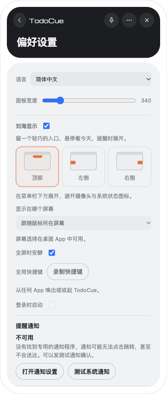
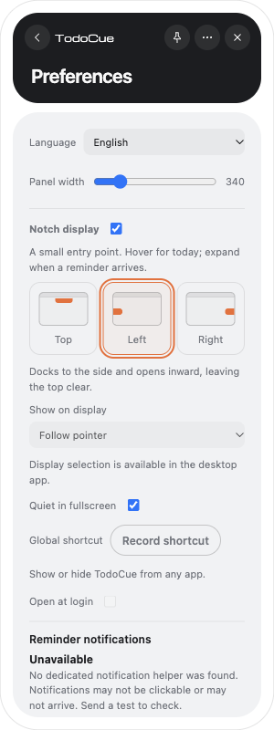

# Issue #26：刘海位置与显示器

2026-10-19，基于 `863a9e8` 的共享 React/Tauri 客户端；旧 SwiftUI 客户端未修改。

## 行为与原因

旧实现把宽 273 点的虚拟刘海放在屏幕顶边，会覆盖菜单栏；每次指针换屏又自动移动，无法选择固定屏幕。

新设置提供顶部 / 左侧 / 右侧单选，以及自动跟随或固定显示器。顶部收起采用摄像头留白 + 两侧各 22 点，上限为原默认 273 点：带摄像头刘海的 Mac 直接贴住屏幕顶边，中间按摄像头实际宽度留空，图标与任务数放在左右两翼；高度跟随摄像头安全区域，不把整个窗口下移。无硬件刘海的屏幕保留菜单栏安全区；左右为 88 × 32 点。侧边位置供用户避开顶部常用内容。

macOS 使用显示器 UUID 持久化选择。目标断开时临时回退主屏，不覆盖原选择；重连后恢复。屏幕列表自动刷新，缺失屏幕有明确提示。保存期间禁用重复操作，失败保留原设置并显示错误。全屏静默按目标屏判断，避免另一屏的前台应用影响固定屏。

## 已完成验证

- `npm run check`：353 项 Vitest、41 项脚本测试、CLI/MCP / 通知 / 重启冒烟及 release 校验通过。
- `npm run desktop:check`：TypeScript / Vite 构建、70 项宿主 Rust + 5 项通知 Rust 测试通过。
- 新回归覆盖：旧设置默认值、非法位置拒绝、固定屏/位置序列化、屏幕重排、断开回退、重连恢复、跟随模式、无屏幕、负坐标、Retina 比例、菜单栏自动隐藏安全区、侧边展开的底部约束与任务栏工作区。
- 初版 Ego Lite 浏览器（顶部宽度已被下述修正取代）：300 点英文、340 点中文设置无横向溢出；位置选择保存；关闭刘海后配置禁用；快览展开至 560 点，Esc 恢复顶部 128 点 / 侧边 88 点。
- 原生 macOS：以独立 `com.todocue.issue26` 和 `/tmp/todocue-issue26` 运行，没有替换正式 App 或使用正式数据。实际识别 `Built-in Retina Display`、1728 × 1117、主屏、内置刘海；通过设置选择后，UUID 与位置写入配置，重启后保留。
- 初版原生窗口实测（逻辑点，顶部已被下述两翼布局取代）：顶部 `(800, 33, 128, 32)`，左侧 `(0, 413, 88, 32)`，右侧 `(1640, 413, 88, 32)`。顶部未进入菜单栏。折叠窗口的原生截图也检查过，黑色底、橙色标记、任务数均可见。
- 目标不可用场景：在隔离配置中保存一个不存在的显示器 UUID，重启后设置显示“QA External Display · 未连接”和临时回退说明；窗口回到主屏，文件仍保留缺失目标。此项是不可用目标模拟，不是物理拔线。
- macOS 按显示器 UUID 查询当前 Space 的动态接口在本机返回有效 Space、普通桌面为非全屏。独立源码审查检查了目标屏全屏逻辑及跨 DPI 坐标契约。
- Windows 新增全屏扫描 API 使用独立最小 Rust 工程在 `x86_64-pc-windows-msvc` 目标通过类型检查；这不等于完整 Windows 构建或 GUI 验证。

## 仍需对应硬件验收

- 两块实际屏幕之间跟随、固定后跨屏操作、物理热插拔、合盖再开盖，以及 1× / 2× 混合 DPI。
- 固定 A 屏全屏、在 B 屏操作其他 App 的实际静默 / 恢复；普通最大化窗口继续显示刘海。
- Windows 原生 GUI、任务栏各边、缩放与热插拔。完整交叉编译在 `ring` C 依赖处受本机缺少 Windows C 工具链阻挡；不能记作通过。Windows 使用 `\\.\DISPLAYn` 系统设备名称，换接口后可能需要重新选择。
- 原生快览展开的自动点击受 CUA 对非激活窗口的定位限制；展开/收起逻辑本轮由浏览器入口验证，原生展开仍应人工复测。

## 设置页截图

以下为浏览器预览；实际显示器列表仅在桌面 App 中可用。

| 中文 · 340 点 | English · 300 pt |
| --- | --- |
|  |  |

目标屏 Space 查询的接口签名参考 [yabai 的调用源代码](https://github.com/asmvik/yabai/blob/master/src/window.c)；继续沿用项目原有的动态符号解析与几何回退方式。

## 摄像头两翼布局（紧凑化之前）

用户明确要求：内容放在摄像头左右，不能整体贴在下沿，收起宽度不得超过原默认值。此前 `(759, 32, 209, 32)` 的下沿方案已撤销。

- 原默认宽度来自本轮基线 `HEAD` 的 `Notch.tsx`：273 点。现在收起时固定为 273 点，不再按摄像头宽度增加外壳宽度。
- 使用 `NSScreen.safeAreaInsets.top` 和左右辅助可见区域读取摄像头高宽，窗口顶边位于屏幕 Y=0；侧边 Dock 不影响水平居中。中间仅放空白 spacer，不放文字或按钮内容。
- 本机原生测量：屏幕 1728 × 1117 点、摄像头 185 × 32 点；新折叠窗口 `(727, 0, 273, 32)`。左右各 44 点，截图可见图标和任务数分别位于两翼：[原生截图](camera-wings-native.png)。
- Ego Lite 实际组件测量：band 273 × 32、spacer 从 X=44 开始宽 185、左翼 X=0 宽 44、右翼 X=229 宽 44。悬停可展开 560 点，Esc 恢复 273 点。
- 浏览器受控布局验证 spacer 为 185 / 210 / 273 点时，总宽保持 273 点，两翼按剩余空间缩小并裁切，内容不进入摄像头区域。该项模拟不同摄像头宽度，不等同多机实测。
- 新回归覆盖贴顶坐标、负坐标、2× 比例、侧边 Dock、固定总宽、中间留白及高度适配。桌面构建、73 项宿主 + 5 项通知 Rust 测试、200 项桌面 Vitest 回归通过。
- API 依据：[安全区域](https://developer.apple.com/documentation/appkit/nsscreen/safeareainsets)、[摄像头左侧可见区域](https://developer.apple.com/documentation/appkit/nsscreen/auxiliarytopleftarea-uglc)。

## Apple 官方资料核对：菜单栏冲突仍未解决

2026-10-19 按用户要求查阅官方资料。本节是设计审查结论，不代表已实现菜单栏自动避让。

- `auxiliaryTopLeftArea` / `auxiliaryTopRightArea` 只描述没有被实体摄像头遮住的区域，不提供其他应用菜单或状态图标的空闲位置；文档的使用场景是自定义全屏体验。不能据此声称两翼不会挡住菜单栏。[Apple 文档](https://developer.apple.com/documentation/appkit/nsscreen/auxiliarytoprightarea-gr2n)
- Apple DTS 工程师针对 macOS 类灵动岛体验建议使用 Menu Bar Extra，紧凑显示动态信息，点击展开，并保持内容简短；不建议把 iPhone 灵动岛外形强行搬到桌面。这是官方工程师的设计建议，不是禁止自定义窗口的规则。[Apple 官方论坛答复](https://developer.apple.com/forums/thread/834361)
- `NSStatusBar` / `NSStatusItem` 由系统分配菜单栏位置。它仍占用有限菜单栏空间，空间不足时状态项可能隐藏；它不能承诺“零占用”或让任意自定义内容固定在摄像头左右。[NSStatusBar](https://developer.apple.com/documentation/appkit/nsstatusbar)、[NSStatusItem.length](https://developer.apple.com/documentation/appkit/nsstatusitem/length)
- 代码审查：`platform::notch_level` 使用 `NSStatusWindowLevel + 1`。窗口层级高于状态栏，重叠时会覆盖；273 点只是本产品的默认宽度，不是 Apple 保证安全的宽度。展开宽度为 560 点，重叠风险还会扩大。[窗口层级](https://developer.apple.com/documentation/appkit/nswindow/level-swift.struct)
- 建议：标准模式使用系统管理的精简状态项；保留用户要求的贴顶两翼作为自定义模式时，将 273 点作为上限，并把菜单栏优先、冲突时缩减或隐藏两翼作为验收条件。冲突检测是否可靠、无法确认空位时如何退让，需要独立实现和实机验证，不能把硬件几何测试当成菜单栏避让验收。

## 最短可读两翼预览

用户进一步要求尽量缩短、给其他菜单栏图标留空间。收起宽度改为 `min(摄像头留白 + 44, 273)`，常规两翼各 22 点；图标缩为 14 点，数字采用紧凑等宽字体，超过两位显示 `99+`，辅助文本仍保留真实数量。

- 本机实测摄像头宽 185 点，原生窗口 `(749, 0, 229, 32)`；此前总宽 273 点、两翼共 88 点，现在两翼共 44 点，额外占用减半。
- [实际原生截图](camera-compact-native.png)。开发版 `com.todocue.issue26` 使用隔离数据 `/tmp/todocue-settings-fixes`。
- 浏览器注入 104 件待办的响应验证 `99+` 在 22 点右翼内完整显示；此项是显示边界测试，未创建真实待办。展开仍为 560 点，Esc 恢复 229 点。
- 桌面构建、73 + 5 项 Rust 测试和 200 项桌面 Vitest 通过。
- 此次缩短减少占用，没有把菜单栏自动避让标为已实现；上节 Apple 官方资料核对的限制仍然适用。
- 图标和数字进一步向摄像头靠拢：左翼右对齐、右翼左对齐，各留 2 点间隙。浏览器测量两侧间隙均为 2 点，`99+` 宽 18.0625 点仍完整容纳；总宽保持 229 点。[更新后的原生截图](camera-inset-native.png)。

## 无摄像头屏幕：在菜单栏里找空位（2026-10-20）

用户报告：外接屏上收起的刘海挂在菜单栏下方，希望放进菜单栏，同时不挡其他图标。

- 复现（正式版 v0.7.0）：BenQ RD280U，1920 × 1280 点，菜单栏 30 点。刘海窗口在 `(845, 30, 229, 32)`，位于菜单栏下方。原因是状态栏图标从 x=979 一直排到右边缘，已经越过中线；菜单栏居中的 `845–1074` 会盖住 3 个图标，所以 Issue #26 之后的代码只能退到菜单栏下方。
- 根因：macOS 排菜单栏图标时不知道虚拟刘海的存在，也没有公开接口能在菜单栏中间预留空间。所以刘海必须自己读出图标位置后再避开。

### 行为

满足三个条件时启用：屏幕没有摄像头、菜单栏可见、刘海位置为“顶部”。

- 读取图标：宿主读取 `CGWindowListCopyWindowInfo` 中位于 `NSStatusWindowLevel` 的窗口，即菜单栏图标。只用位置和层级，不需要屏幕录制权限。macOS 26 把这些窗口全部托管在“控制中心”下，TodoCue 自己的托盘图标也计算在内。
- 外形：刘海贴住屏幕顶边，高度等于菜单栏，宽度与内建屏刘海相同（229 点）。曾试过 60 点的紧凑胶囊，用户认为太窄，已撤回。
- 找位置：
  - 中间空着就居中。即使窄屏的中心落在应用菜单保留区内，也允许居中。
  - 中间被占时，放在离中心最近的空位，两侧各与图标相隔 8 点。
  - 被图标往左挤时，不进入左侧 640 点的应用菜单保留区。
- 稳定性：当前位置仍然放得下、最佳位置又只差 24 点以内时，刘海不动。所以图标宽度的小变化（TodoCue 自己的数字出现或消失约 16–18 点、时钟多一位）不会让它跳。新图标出现或图标消失时它会让位。
- 更新时机：
  - 刘海收起并缩回原尺寸后，每 0.5 秒重新查找一次。
  - TodoCue 托盘标题变化后，连续 8 个循环（每 0.1 秒一次）都会查找。
  - 展开的快览和提醒堆叠以刘海中心为准，并限制在屏幕内；展开和收起的动画期间位置不变，缩回原尺寸后才会移动。
  - 显示器排列或刘海设置变化时，清掉记住的位置。
  - 找位置只移动刘海窗口，不再触发面板的 `fit_panel`。
- 菜单栏整理工具：Ice、Hidden Bar、Bartender 用一个拉长到几千点的空状态项来隐藏图标。凡是越过屏幕左边缘、或宽度超过半屏的状态栏窗口，只把它的右端当作需要避开的位置。
- 退回：找不到空位、菜单栏自动隐藏、该屏没有菜单栏或读不到窗口列表时，刘海仍在原来菜单栏下方的位置。只要菜单栏可见，高度就等于菜单栏，本机是 30 点，不再是原来的 32 点。
- 设置页：
  - 没有摄像头的 Mac 屏幕上，“顶部”预览把刘海画在菜单栏条内，提示文字也说明会放进菜单栏的空位。
  - 带摄像头的屏幕沿用原来的说明。
  - Windows 显示“贴住屏幕顶部居中，避开任务栏”。
  - [设置页截图 · English 340](settings-menu-bar-en-340.png)

### 复审发现与处理

| # | 发现 | 处理 |
|---|---|---|
| 1 | 应用菜单可能被盖住；窄屏永远无法居中，README 说法不准 | 中心始终允许；640 点只限制被图标往左挤的情况。应用菜单宽度仍是经验值（见下） |
| 2 | 多一个大图标就退回菜单栏下方 | 保留：229 点宽时这是预期的取舍（实测见下）。新图标被盖住的时间从最多 1 秒缩短到最多约 0.5 秒 |
| 3 | 托盘数字变化压住托盘图标；收起时卡片横跳 | 位置稳定规则；托盘标题变化后立即快速查找；动画期间位置不变 |
| 4 | 菜单栏整理工具导致一直退回 | 超长状态项只算右端（本机未安装，仅纯函数测试） |
| 5 | 位置变化重设面板尺寸，可能吞掉刚调好的大小 | 找位置与布局变化分开，只移动刘海 |
| 6 | 设置页预览仍是旧位置 | 已改，见上 |
| 7 | 文档说得比验证多 | 本节已改写；上一版“托盘图标出现后刘海随即移到 696”当时并未观察到移动过程，已由下方实验替代 |

### 验证

- Rust 测试：`notch_geometry` 的菜单栏测试覆盖了以下情况：
  - 实测图标布局下左缘为 742；
  - 中心空闲时居中，窄屏也一样；
  - 多段空位取最近的一段；
  - 被挤时不进入保留区，放不下时退回；
  - 只计入本屏菜单栏内的图标（含负坐标）；
  - 图标宽度变化时位置不动、新图标出现时让位；
  - 菜单栏整理工具的长空状态项；
  - 展开卡片限制在屏幕内。
- 受控回归：
  - 忽略全部图标（等于回到“总是居中”）时，6 项测试失败。
  - 去掉位置稳定规则、去掉长空状态项的判断、或改回“中心也受 640 点限制”时，各有 1 项测试失败。
- 原生实测：调试构建使用独立 identifier `com.todocue.menubarslot`，数据目录和运行时（47836）都是隔离的，提醒使用桩通知器，与正式版同时运行。用 100 毫秒间隔记录窗口位置。
  - BenQ，静止：刘海在 `(696, 0, 229, 30)`，即最左侧图标 933 − 8 − 229。前台 Warp 的菜单止于 538 点。[原生截图](menu-bar-slot-native.png)
  - 新增一个今日提醒任务：托盘出现数字后最左侧图标变为 917，约 0.4 秒内刘海移到 `(680, 0)`。
  - 临时加一个 80 点宽的状态栏图标：最左侧图标变为 821，821 − 8 − 229 = 584 落入保留区，于是退到 `(845, 30)`。
  - 提醒到点：提醒堆叠以 `x=960` 为中心展开。堆叠打开期间临时图标消失，堆叠位置不变。
  - 完成任务：堆叠收起时中心始终在 959.5–960，没有横跳；缩回原尺寸后，刘海回到菜单栏 `(696, 0)`。
  - 同一套实验在 60 点胶囊阶段还观察到：新图标出现约 0.1 秒内刘海就让位；用户悬停打开的快览以刘海中心展开，打开期间托盘变窄也没有移动；托盘变窄 16 点时刘海保持原位。
  - 左侧 Redmi 27 NU（2304 × 1296 点，顶边在全局 y=174）：指针移过去后，刘海跟到 `(-1267, 174, 229, 30)`。该屏图标从 -987 开始，中心是空的，所以居中显示。
- 浏览器（Ego Lite，独立 Vite 5180 端口）：中文 340 点与英文 300 / 340 点下，“顶部”预览都画在菜单栏条内，没有横向溢出。

### 限制与未验证

- 前台应用菜单：没有辅助功能权限就读不到它的宽度。本机用辅助功能实测了 22 个正在运行的应用，最宽的是 Chrome / ego lite，菜单右缘在 594 点，640 点由此而来。这是经验值，不是系统保证：
  - 菜单更长的应用（Xcode、JetBrains、Office、Adobe 等，本机未测）仍可能被盖住；
  - 屏幕窄于约 1509 点时，居中的刘海也会落入这个区间。
- 未在真机验证：
  - Ice / Bartender 等菜单栏整理工具；
  - 菜单栏自动隐藏；
  - “显示器使用独立空间”关闭时的副屏；
  - 关闭“全屏时安静”后的全屏 Space；
  - RTL 系统语言（应用菜单在右侧）；
  - 带摄像头的内建屏（这次合着盖；代码路径不变，原有测试通过）。
- Windows / Linux：菜单栏高度恒为 0，不进入这套逻辑。只审过 `cfg` 分支，没有编译这两个目标。
