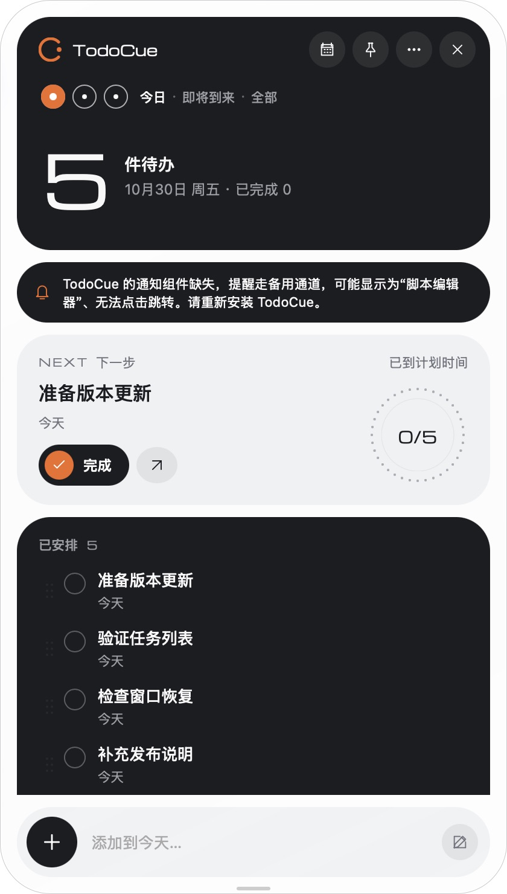

# 面板列表显示修复验收

日期：2026-10-30。实现提交：`4c33162`。使用独立数据目录与五个通用测试任务，没有读写日常任务数据。

## 原问题与受控复现

原报告中，右侧面板显示 5 件待办及 NEXT 卡片，下方列表为空；刘海窗口中任务正常。浏览器预览通过在入场阶段停止投递 `requestAnimationFrame` 回调模拟动画中断，旧实现中的列表和快速添加栏持续为 `opacity: 0`。使用同样条件，新实现的临时浏览器动画结束后，列表和添加栏均恢复 `opacity: 1`，位移效果释放。

这证明旧动画路径存在可复现的显示缺陷，不证明用户原安装包中断动画的唯一原因。

## macOS 原生窗口

本机使用修改后源码构建 `TodoCue Review.app`（Tauri debug bundle、独立应用标识 `dev.todocue.release-review`），连接隔离运行时，通过原生 Computer Use 检查：

- 今日显示 5 件待办，任务列表和底部快速添加栏可见。
- 点击收起后，通过同一测试 App 的二次启动路由重新打开，五项任务及添加栏重新出现。
- 切换全部视图，打开任务详情，再返回列表和今日视图，数据与可见性正常。
- 截图中的通知组件缺失提示来自未打包通知 helper 的 debug 测试运行时；本次未验证通知，也未替换 `/Applications/TodoCue.app`。

窗口为 420×740 逻辑像素，列表按剩余空间滚动；第五项位于截图的列表滚动区域下方，原生可访问性树包含完整五项任务。

## 自动检查与边界

- `npm run check`：426 项 Vitest 测试、46 项发布脚本测试、CLI/MCP/持久化/提醒冒烟及版本合同检查通过。
- `npm run desktop:check`：共享前端编译与 117 项 Rust 测试通过。
- 独立上下文的一名 Agent 审查本次实现，未发现已确认的功能缺陷；另行复跑相关三个测试文件共 30 项通过。

浏览器受控中断并非 WKWebView 内部暂停实验。尚未覆盖 Windows GUI、原用户安装包原故障重现、系统睡眠恢复、多显示器与全部减少动态效果硬件交互；发布流水线的四平台打包和安装冒烟结果以对应 Actions 运行记录为准。
