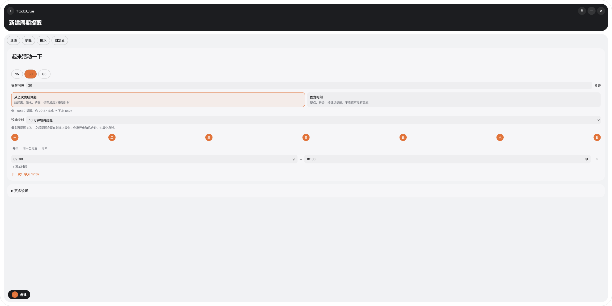
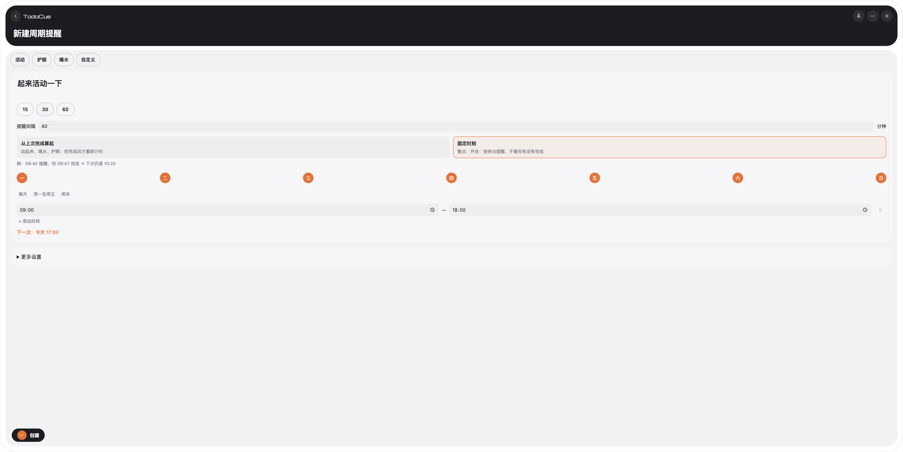

# 周期提醒：习惯型计时、追提醒、离开电脑算休息

2026-10-21。动机：久坐提醒的目的是打断连续久坐，度量应是“距上次真正起身多久”，而不是钟表网格。

## 改了什么

- **默认计时方式改为 `after_completion`**（从上次完成算起）；新增 `followUpMinutes`（默认 10，0 关闭）：提醒已展示但没人回应时，同一次提醒作为下一轮 `round` 再次提醒，最多 3 次，之后停留在刘海等待。延后算一次回应，追问次数清零。`fixed` 不变。已保存的规则保留各自的 `mode`；旧规则读作 `followUpMinutes = 10`。
- **离开电脑算休息**：`POST /v1/periodic-reminders/away`。桌面宿主每 15 秒读系统空闲时间，空闲 ≥5 分钟后回来、或机器睡眠过，就上报；运行时把习惯型规则的待处理提醒收成已完成（`handledVia: "away"`）并从此刻重新计时。设置项 `awayCountsAsBreak`，默认开。
- **界面**：计时方式从“更多设置”提到表单中部，改为两张卡片并给出实例（“09:40 提醒，你 09:47 完成 → 下次 10:27 / 仍是 10:20”）；新增“没响应时”；模板（活动 40 / 护眼 20 / 喝水 60）连同计时一起带出；刘海行由“已等 N 分钟”改为“已超 N 分钟”（自首次到期起算，≥10 分钟变暖色，延后过加“已推迟 N 次”）；规则列表状态由“等待确认”改为“已超时 N 分钟”。

## 自动检查（本地）

- `npm run check` 通过：389 项 Vitest（评审修正后；修正前 383），其中引擎周期测试 32 项（新增 8 项：新默认值与 summary、追提醒最多三次、四种不追提醒的场景、延后重置、旧规则读默认值、离开收尾并重新计时、离开的忽略条件）、服务端路由、CLI `--follow-up`、桌面端 helper 5 项；脚本测试 41 项；CLI/MCP 冒烟；release check。
- `npm run desktop:check` 通过：前端构建；Rust 104 项（新增 `away_tracker` 11 项、设置默认/旧文件迁移、请求路径与 body）。

## 真实入口验证（隔离 `TODOCUE_HOME`，不碰用户数据）

- 浏览器（`desktop:dev` 同款 Vite 代理）里：新建表单默认选中“从上次完成算起”；点“活动/喝水”模板带出间隔与追提醒；切到“固定时刻”后实例改为“仍是 10:20”、“没响应时”隐藏，运行时给出的下一次随模式变化；点创建后 CLI 读到 `mode: after_completion, followUpMinutes: 10`。
- 真实调度器（系统通知换成无输出的假 helper，不会弹真实通知）：间隔 1 分钟、追问 1 分钟的规则，逐轮 round 1→2→3→4（followUps 0→3），第 4 轮后不再追；随后 `periodicAway(5)` 返回该规则 ID，提醒记为 completed，下一次为 1 分钟后。

## 评审后修正（2026-10-21）

独立复核后修了四处：MCP 创建工具描述仍写"默认 fixed"（新增 `mcp-periodic.test.ts` 守护，旧文案下会失败）；追提醒重新排期的 ≤5 秒内刘海行被 `CueStack.sync` 删掉且 ×N 清零（现保留该行，延后仍会删除，见 `cue-stack-follow-up.test.ts`）；"已推迟 N 次"在追提醒后多算（运行时新增不重置的 `snoozes` 计数）；唤醒/启动那一次调度之后下一次调度就会追提醒，与文档不符（现在唤醒会让追提醒的等待重新开始）。

## 未验证（需要真机）

- 真实空闲读取：macOS `CGEventSourceSecondsSinceLastEventType` 只验证了能返回数值；锁屏、睡眠唤醒后的读数，以及“回来后上报 → 运行时收尾 → 刘海行消失”整条链路，需在真机按下面清单走一遍。
- Windows 的 `GetLastInputInfo` 路径只做了类型检查（本机缺 Windows SDK，整 crate 无法编译），**已实现但未验证**。
- 刘海上追提醒再次整卡落下、×N 累计的观感。

## 真机验收清单

1. 建一条 `--every 3 --follow-up 1` 的习惯规则；到点后不理，约 1 分钟后应再弹一次，共再弹 3 次，之后刘海行只留“已超 N 分钟”（≥10 分钟变暖色）。
2. 另建一条 `--every 10`；到点前离开电脑 6 分钟（锁屏），回来后 15 秒内该规则的下一次提醒应顺延到“回来 + 10 分钟”，若已有待处理提醒应消失；历史里该次为 completed。
3. 设置里关闭“离开电脑也算休息”，重复第 2 步，计时不应变化。
4. 固定时刻规则不受以上任何一项影响。

## 截图

浏览器（Vite 代理）里的新建表单，窗口比真实面板宽所以被拉伸；"活动"模板之后分别选中两种计时方式：

