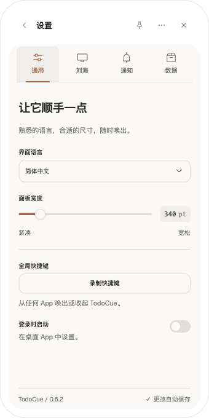
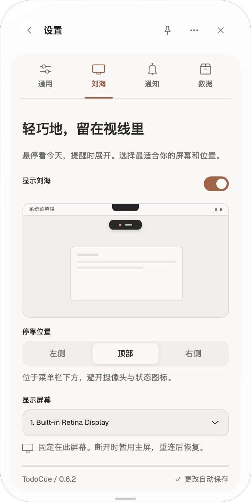
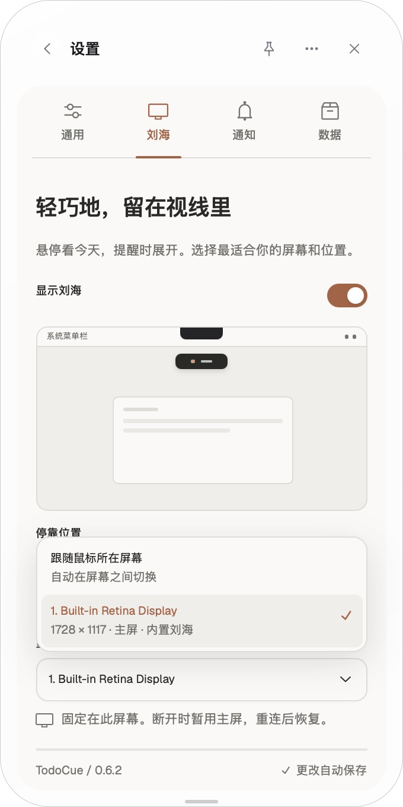
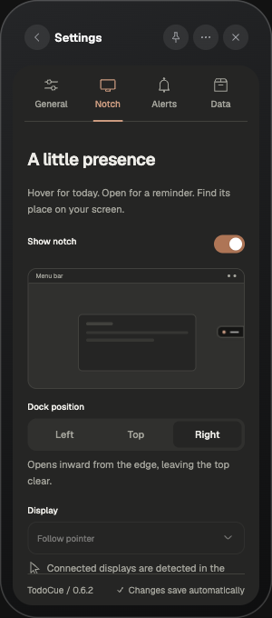

# 设置面板重构验证

2026-10-19。接续 issue #26 的显示器与安全停靠功能，将偏好设置完整重构为通用 / 刘海 / 通知 / 数据页签。

## 设计与组件

- 暖灰底色、单一陶土色强调、Geist + 系统中文字体。设置页使用轻量窗口标题，其余页面保留原有样式。
- Radix 负责开关、选择器、滑杆、单选分段与页签的键盘行为；Tailwind 4 使用 `tw:` 前缀，不引入全局 preflight。
- 一个屏幕预览展示停靠方向，以及检测到的硬件刘海；选项下拉提供屏幕名、分辨率、主屏和摄像头刘海信息。
- 宽度滑杆保存期间保持可操作，串行写入并合并连续输入；其他偏好控件禁用，成功后应用。失败保留旧值并显示可重试的就地错误。手动重连失败会抛给操作反馈，后台自动刷新仍通过状态报告错误。
- 固定页签栏和自动保存提示，内容独立滚动；切换页签回到顶部。保留快捷键、开机启动、通知、数据文件夹及诊断功能。

## 环境

- macOS 内置 Retina 屏幕，1728 × 1117 逻辑点。
- 独立测试 App `com.todocue.issue26`，数据目录 `/tmp/todocue-issue26`；未修改已安装 App 的用户设置。
- Ego Lite 浏览器预览与实际本地 runtime；CUA 操作原生 Tauri WebView。

## 已验证

| 场景 | 结果 |
| --- | --- |
| 中文 340 × 680、英文 300 × 680、深色模式 | 截图目视检查，文本和控件无横向溢出 |
| 600 点宽与 300 × 360 最小窗口 | 根布局无横向溢出，内容可滚动到末尾，切换页签恢复顶部 |
| 语言切换、滑杆方向键 | 正确保存；宽度从 340 → 350 → 340 |
| 快捷键录制与 Esc 取消 | 保留原设置，设置页不关闭 |
| 停靠选择、刘海开关、全屏安静 | 更新保存值与预览；关闭刘海后禁用关联控件 |
| 存储写入失败（浏览器注入） | 新位置未被采纳，旧位置与存储一致；撤销故障后重试成功 |
| 诊断请求失败（浏览器注入） | 显示失败原因；撤销故障后重试成功 |
| 原生显示器选择 | 识别 Built-in Retina Display、分辨率、主屏、内置刘海；键盘选择跟随模式后再固定，文案和值同步 |
| 原生菜单 Esc | 只关闭下拉菜单，焦点回到触发器，面板保留 |
| 减少动态效果 | 在该偏好下切换页签与停靠可操作；新增预览禁用 layout 动画，开关与骨架动画关闭 |

外接多显示器热插拔和 Windows 原生 GUI 尚未实机验收；底层行为及既有测试见 [issue #26 记录](../notch-display/README.md)。未在真实账户中执行开机启动或修改系统通知授权。

## 质量检查

- `npm run check`：357 项 Vitest、41 项脚本测试通过；smoke 与 release check 通过。
- `npm run desktop:check`：React/TypeScript/Vite 构建、73 项宿主 Rust 测试、5 项通知程序测试通过。
- 最后交互修正后重新执行桌面前端 build，通过。
- `git diff --check` 通过。

## 截图

| 通用（中文） | 刘海（原生屏幕） |
| --- | --- |
|  |  |

| 显示器下拉（原生） | 深色英文最小宽度 |
| --- | --- |
|  |  |

其他：[英文通用](general-en-300.png)、[通知](alerts-en-300.png)、[数据](data-zh-340.png)。

## 审查后修复与原生复测

独立原生 App `com.todocue.issue26`，数据 `/tmp/todocue-settings-fixes`，2026-10-19。

- 修前：滑杆每次保存都被禁用，WebKit 将焦点移到 HTML 根节点，第二次方向键无效。修后：点击一次后 Right 连续调整 340 → 350 → 360 → 370 → 380，Left 回到 370；AX 焦点始终是滑杆。Tab 正常移到快捷键按钮，重载后宽度仍为 370。
- 写入回归测试覆盖延迟保存期间合并最终值、合并其他设置、写入失败后保留确认值并继续处理新输入、同步失败后重试成功。
- 修前：停止隔离 runtime 后点“重新连接”，界面同时显示离线与“已完成”。修后：停止同一开发入口，重连显示 `Runtime unavailable`，不出现成功提示；恢复 runtime 后重连显示“已完成”。
- 原生证据：[滑杆](slider-keyboard-fixed.png)、[断线重连](reconnect-failure-fixed.png)。
