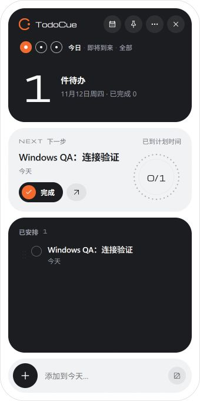

# Windows 启动、外框与拖拽修复（2026-11-12）

本轮目标：Windows 打开 App 后自动连接本机后台，离线重试能够恢复服务，标题栏能作为明确的窗口拖拽区域。

## 原因与改动

- 在本机 Node 26.7.0 上，同一 CLI 的普通路径执行 `--version` 返回 `0.10.2`，`\\?\C:\...` 和 `\\?\D:\...` 路径均报 `EISDIR: lstat 'C:' / 'D:'`。Tauri 返回的资源路径包含此前缀，因此 GUI 启动的 Node 在加载主模块前就退出；手动 CLI 初始化使用普通路径，可以成功启动。
- 对传给 Node 的资源路径使用 `dunce::simplified`。启动和 `runtime_reconnect` 共用串行初始化逻辑，避免离线横幅仅反复请求一个没有运行的后台。初始化结果保存在数据目录的 `logs/desktop-bootstrap.log`；连接文件过期时仍保留初始化错误。
- Windows 面板关闭默认无边框阴影，使自定义圆角壳不再叠加原生白边和隐藏的边框偏移。Tauri 的[窗口阴影说明](https://v2.tauri.app/reference/javascript/api/namespacewindow/)说明该阴影会给 Windows 无边框窗口添加白边；Acrylic 与 macOS 原生玻璃路径保留。
- Logo、应用名称和整行标题空白都能发起拖动；按钮仍处理自己的点击，任务标题和备注保留文字选择。显式拖拽解除 Windows 被动展示的激活限制；拖动失败会显示错误。
- 为 Windows 尺寸手柄补充 `core:window:allow-start-resize-dragging` 权限。

## 验证

| 边界 | 结果与证据 |
| --- | --- |
| 原版 GUI 冷启动 | 独立新目录只有设置文件，无 `connection.json` 或后台进程；手动初始化后可连接 |
| 修复版 GUI 冷启动 | 隔离目录出现 `Runtime setup succeeded`，后台日志记录监听随机本地端口，真实 `/v1/board` 可读 |
| Node 路径回归 | Rust 测试使用实际 Node、带空格和中文的路径、`canonicalize` 返回的 Windows 前缀，运行测试入口并检查初始化成功 |
| 失败诊断回归 | 缺少内置 Node、子进程非零退出均返回错误并保存相同诊断日志 |
| UI → API → 数据 → UI | 浏览器快速添加「Windows QA：连接验证」，重新加载后仍显示，真实 board 中该标题只有一条 |
| 标题按钮和窄窗口 | 日历按钮正常进入日历；300px 宽度下四个标题按钮均在视口内；标题行 `user-select: none` |
| 页面日志 | 浏览器没有记录 error |
| 质量检查 | `npm run check` 通过：431 项 Vitest 通过、1 项跳过；41 项脚本测试通过、5 项跳过；6 组 CLI/MCP/调度/持久化冒烟通过；版本检查通过 |
| 桌面构建与 Rust | 前端构建通过；Rust 97 项库测试、14 项通知程序测试、4 项运行时宿主测试通过；Windows x64 release 主程序构建通过 |

补充的 NSIS 检查会先启动实际 GUI，再等待后台健康，避免先调用 CLI 安装掩盖首次启动故障。本轮没有运行整套 NSIS 安装/升级/卸载检查，也没有执行 macOS 构建或实机回归。

## 视觉证据与限制

下图是 340×680 的共享前端预览，连接到真实隔离后台，**不代表 Windows 原生外框截图**。

原生自动化工具对修复版窗口返回 `window is not a usable app window`，无法完成原生外框、真实鼠标拖动和尺寸手柄的截图验收。Ego Lite 命令也无法连接本地 bootstrap，浏览器验证改用内置浏览器完成。不得将共享前端截图或单元测试视为这些原生交互已经实测通过。

本机旧主程序保存在工作区 `.desktop-qa/windows-2026-11-12/todocue-desktop-original.exe`。修复以同版本本地热修复主程序替换，未发布 Release、未生成新安装包。测试创建的两个独立后台服务、CLI PATH 项和数据目录登记已清理，测试数据库留在被忽略的 QA 目录中。
